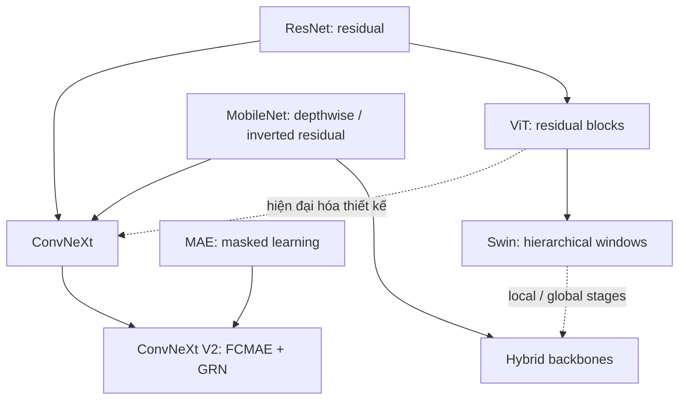
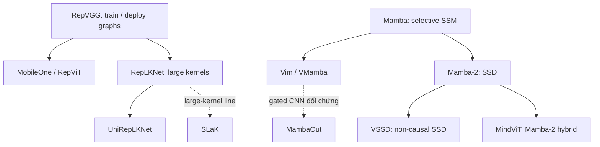

# Nghiên cứu kiến trúc thị giác 2012–2026

## CNN, Vision Transformer, hybrid CNN–Transformer và State Space Model

**Mốc dữ liệu:** tra cứu ngày **09/10/2026**. Công bố mới nhất được phân tích trực tiếp trong khảo sát này là **LiAuto-MindViT, arXiv v2 ngày 22/09/2026**. Phạm vi nền là 2012–2019; trọng tâm là 2020–2026. Các bài 2026 được ghi theo trạng thái xác minh được, không mặc nhiên xem arXiv là đã qua phản biện.

## Tóm tắt điều hành

Kiến trúc thị giác tiến hóa theo ba trục: khả năng biểu diễn, khả năng tối ưu và hiệu quả thực thi. AlexNet chứng minh giá trị của deep CNN trên dữ liệu lớn; ResNet biến residual learning thành nền tảng dùng lâu dài. Từ 2020, ViT cho thấy convolution không bắt buộc nếu có đủ pretrain. Tuy nhiên, ConvNeXt, RepLKNet và các nghiên cứu recipe cho thấy CNN vẫn cạnh tranh khi được thiết kế và huấn luyện trong điều kiện hiện đại.

Không thể gán toàn bộ tiến bộ cho token mixer. ResNet strikes back cải thiện một ResNet-50 giữ nguyên kiến trúc; ConvNeXt kiểm soát recipe rồi mới thay kiến trúc; ConvNeXt V2 đồng thiết kế kiến trúc và masked pretrain. MAE, EVA, DINOv2 và DINOv3 làm nổi bật vai trò của objective, teacher, dữ liệu và curation.

Hybrid dùng convolution ở độ phân giải cao và attention ở tầng sâu thường đạt cân bằng tốt. Visual Mamba mở hướng global mixing với chi phí tuyến tính theo số token, nhưng phải xử lý việc ảnh không có thứ tự nhân quả, thiên lệch scan và chi phí triển khai. MambaOut, VSSD và các bài 2026 cho thấy chưa có đồng thuận rằng selective scan là lựa chọn tốt nhất cho mọi bài toán thị giác.

Kết luận thực hành: đánh giá **kiến trúc + recipe + dữ liệu + phần mềm + phần cứng** như một hệ thống. ImageNet top-1 không đủ để xác định backbone tốt nhất cho dense prediction, frozen features, độ bền vững hay thiết bị di động. Báo cáo dưới đây tách sự kiện, diễn giải và giả thuyết; không lập bảng xếp hạng từ các thí nghiệm khác điều kiện.

## Mục lục

1. [Phương pháp đọc bằng chứng](#1-phương-pháp-đọc-bằng-chứng)
2. [CNN nền tảng và thiết kế hiệu quả](#2-cnn-nền-tảng-và-thiết-kế-hiệu-quả)
3. [CNN hiện đại hóa](#3-cnn-hiện-đại-hóa)
4. [Vision Transformer và pretrain](#4-vision-transformer-và-pretrain)
5. [Hybrid và backbone nhẹ](#5-hybrid-và-backbone-nhẹ)
6. [State Space Model và visual Mamba](#6-state-space-model-và-visual-mamba)
7. [NAS, scaling và MetaFormer](#7-nas-scaling-và-metaformer)
8. [Dòng thời gian và kế thừa ý tưởng](#8-dòng-thời-gian-và-kế-thừa-ý-tưởng)
9. [Các viên gạch thiết kế](#9-các-viên-gạch-thiết-kế)
10. [Kiến trúc, recipe và cuộc tranh luận backbone](#10-kiến-trúc-recipe-và-cuộc-tranh-luận-backbone)
11. [Bảng so sánh tổng hợp](#11-bảng-so-sánh-tổng-hợp)
12. [Xu hướng mới và những điểm chưa đồng thuận](#12-xu-hướng-mới-và-những-điểm-chưa-đồng-thuận)
13. [Các bài nên đọc đầu tiên](#13-các-bài-nên-đọc-đầu-tiên)
14. [Tài liệu tham khảo và mã nguồn](#14-tài-liệu-tham-khảo-và-mã-nguồn)

## 1. Phương pháp đọc bằng chứng

**Nguồn:** bài báo gốc, proceedings, repo của tác giả và tài liệu chính thức của timm/TorchVision. Mỗi mã **[Rxx]** dẫn đến tài liệu và mã nguồn ở cuối báo cáo. Bảng số liệu có nguồn ở từng dòng. Repo có thể chứa checkpoint hoặc recipe cập nhật sau bài gốc; hai loại kết quả được ghi riêng.

**Nhãn bằng chứng:**

- **[Xác minh]**: nguồn chính trực tiếp nêu thiết kế hoặc kết quả. Đây vẫn là kết quả do tác giả báo cáo, không phải thí nghiệm chúng tôi tự chạy.
- **[Diễn giải]**: phân tích cơ chế, hạn chế hoặc ảnh hưởng từ thiết kế và bằng chứng đã đọc.
- **[Giả thuyết]**: lời giải thích hoặc khả năng cần thêm thí nghiệm; không được xem là kết luận.
- **KXV** trong bảng = **không xác minh được** con số hoặc cấu hình tương ứng trong phần nguồn đã kiểm tra. Không suy ra từ model khác.

**Quy trình tác giả** ở đây là quy trình được mô tả trong bài: baseline, thay đổi, ablation và lựa chọn cuối. Không tái dựng những thử nghiệm thất bại không được công bố. Khi chưa trích được số chênh lệch, báo cáo nêu thiết kế thí nghiệm và ghi rõ chưa xác minh được delta.

**Đơn vị:** M = triệu parameters; G = tỷ operations. FLOPs/MACs giữ quy ước của nguồn: có nơi một multiply–add được tính là một operation, có nơi là hai. Không tự nhân đôi hoặc chia đôi để tạo một bảng “đồng nhất” giả. Top-1 là ImageNet-1K validation trừ khi ghi khác. **pp** là điểm phần trăm, khác phần trăm cải thiện tương đối.

**Training metadata:** cột regime tóm tắt supervision, pretrain/distillation và schedule khi đã đối chiếu; nó không thay toàn bộ config trong repo. Những thông số optimizer/lr/augmentation không được nêu cho một dòng là **chưa xác minh đầy đủ trong báo cáo**, không được ngầm coi giống model khác. Các tên IN-21K/IN-22K giữ theo nguồn và phiên bản dữ liệu, không tự quy đổi.

**Hạn chế của khảo sát:** đây là tổng quan có chọn lọc theo các họ được yêu cầu, không phải chứng minh đã tìm hết mọi preprint trước mốc dữ liệu. Các nhận xét cộng đồng chỉ được dùng khi có nghiên cứu gốc kiểm chứng; không biến nhận xét trên mạng thành bằng chứng thực nghiệm.

## 2. CNN nền tảng và thiết kế hiệu quả

Thông tin tác giả, năm, bài gốc và code của từng họ nằm ở [R01]–[R18]. Các kết quả minh họa cụ thể nằm ở mục 11. Với những bài đầu thời kỳ CNN, không đổi top-5 test/ensemble của bài gốc thành top-1 single-crop; các checkpoint TorchVision được ghi rõ là triển khai về sau.

### 2.1 AlexNet — 2012, Krizhevsky, Sutskever và Hinton, University of Toronto [R01]

**Động cơ → thiết kế.** [Xác minh] ImageNet đủ lớn nhưng mạng sâu khó huấn luyện và dễ overfit. AlexNet kết hợp deep convolution, ReLU, GPU training, data augmentation và dropout; model được chia trên hai GPU vì giới hạn bộ nhớ. LRN xuất hiện trong thiết kế gốc.

**Tác giả kiểm tra gì?** So sánh tốc độ học ReLU với tanh, tác dụng LRN, overlapping pooling và regularization. Đây là đóng góp đồng thời của kiến trúc và hệ thống huấn luyện; không phải phát minh CNN hay ReLU.

**Kết quả/ảnh hưởng/hạn chế.** Bài gốc tạo bước ngoặt ILSVRC; bảng 11.1 dùng checkpoint về sau, không dùng nó để đại diện kết quả thi 2012. [Diễn giải] ReLU, GPU training và augmentation tồn tại; LRN dần mất vai trò trong các họ được khảo sát. Fully connected head lớn và downsampling mạnh khiến AlexNet khó dùng trực tiếp cho dense prediction hiện đại.

### 2.2 VGG — 2014 preprint/ICLR 2015, Simonyan và Zisserman, Oxford VGG [R02]

**Động cơ/cốt lõi.** [Xác minh] Tách ảnh hưởng của depth khỏi thiết kế kernel phức tạp. Dùng các lớp 3×3 đều đặn: nhiều lớp nhỏ tạo receptive field lớn và thêm nonlinearities.

**Quy trình.** So sánh các cấu hình A–E tăng độ sâu trong cùng khung, xét 1×1 và chiến lược multi-scale training/testing. Chưa xác minh đầy đủ delta từng cấu hình trong bản trích này.

**Kết quả/di sản.** VGG16/19 thành backbone transfer phổ biến; số minh họa ở bảng 11.1. [Diễn giải] Kiến trúc đơn giản giúp nghiên cứu, nhưng FC head và convolution dày gây tốn parameters, compute. Ý tưởng “stack small kernels” sống lâu; các CNN kernel lớn về sau chứng minh nó không phải quy luật tối ưu phổ quát.

### 2.3 Inception/GoogLeNet — 2014/2015, Szegedy et al., Google [R03]

**Động cơ/cốt lõi.** [Xác minh] Tăng depth/width trong compute budget hạn chế. Inception xử lý nhiều scale song song, dùng 1×1 giảm channel trước convolution đắt; GoogLeNet sử dụng global average pooling và auxiliary classifiers.

**Quy trình.** Thiết kế thủ công từ multi-scale processing và lập luận sparse connectivity, sau đó hiện thực bằng dense branches; không phải NAS. Các đời Inception tiếp tục factorization và normalization.

**Kết quả/di sản.** Thành công classification và detection ILSVRC; bảng 11.1 ghi checkpoint single model về sau. [Diễn giải] Multi-branch scale mixing truyền tới InceptionNeXt. Nhiều branch làm latency phụ thuộc implementation; không được xem lợi ích của auxiliary loss là lợi ích của token mixer.

### 2.4 ResNet — 2015/CVPR 2016, He et al., Microsoft Research [R04]

**Vấn đề.** [Xác minh] Plain network sâu hơn có training error cao hơn: degradation là vấn đề optimization, không chỉ overfitting. Residual block học F(x), đầu ra x+F(x).

**Quy trình.** So sánh plain/residual ở cùng depth; xét identity/projection shortcuts, bottleneck và scale lên 152 layers. Bài báo phân tích CIFAR với mạng sâu hơn nữa. Residual không bảo đảm gradient không bao giờ biến mất; nó tạo đường truyền identity dễ tối ưu.

**Kết quả/di sản.** Bài gốc báo top-5 test ensemble 3,57%; không so trực tiếp với top-1 của bảng 11.1. [Diễn giải] Skip và bottleneck trở thành nền của CNN, ViT và SSM. ResNet còn là baseline quan trọng nhưng phải cập nhật recipe, như [R53] chỉ ra.

### 2.5 DenseNet — 2016/CVPR 2017, Huang et al. [R05]

**Động cơ/cơ chế.** [Xác minh] Tăng feature reuse và đường truyền gradient: mỗi layer nhận **concatenation** của các feature trước, khác phép cộng của ResNet. Growth rate k quyết định lượng feature mới; bottleneck và transition compression giảm chi phí.

**Quy trình.** Ablation growth rate, depth, bottleneck/compression và đối chiếu hiệu quả parameters. Kết quả classification ở bảng 11.1.

**Di sản/hạn chế.** [Diễn giải] Parameter efficiency không đồng nghĩa activation-memory efficiency: concatenation giữ nhiều feature và gây memory traffic. Dense connectivity chưa bị “loại bỏ”: RDNet [R34] hiện đại hóa lại chính ý tưởng này, cho thấy kết luận về kiến trúc có thể thay đổi khi recipe và operators đổi.

### 2.6 ResNeXt — 2016/CVPR 2017, Xie et al., FAIR/UC San Diego [R06]

**Vấn đề/cốt lõi.** [Xác minh] Thay đổi block bằng tay quá phức tạp. ResNeXt giữ block đồng dạng, aggregate nhiều transformations qua grouped convolution. **Cardinality** là số nhóm/paths, một trục scale khác depth và width.

**Quy trình.** So sánh tăng cardinality với tăng depth/width trong complexity gần tương đương; kiểm tra ImageNet và COCO. Đừng đồng nhất cardinality với số attention heads.

**Kết quả/di sản/hạn chế.** Bảng 11.1 ghi rõ checkpoint tái huấn luyện. [Diễn giải] Group conv truyền tới ShuffleNet và các CNN hiệu quả; ConvNeXt đẩy việc tách spatial/channel mixing đến depthwise. Cardinality lớn vẫn có thể giảm hardware utilization khi nhóm quá nhỏ.

### 2.7 SENet — 2017/CVPR 2018, Hu, Shen và Sun [R07]

**Động cơ/cơ chế.** [Xác minh] CNN ít mô hình hóa tương quan channel một cách tường minh. **Squeeze** dùng global pooling; **Excitation** học channel gates để reweight feature phụ thuộc ảnh.

**Quy trình.** Cắm SE vào các backbone, xét reduction ratio và vị trí module. Đây là channel attention, không phải pairwise spatial self-attention. Chưa xác minh lại toàn bộ delta ablation trong báo cáo này.

**Kết quả/di sản/hạn chế.** SE-ResNet-50 ở bảng 11.1 là số của bài gốc. [Diễn giải] SE trở thành module của MobileNetV3, EfficientNet, NFNet và các CNN mới. Global pooling mất bố cục spatial; thêm FC/gating có chi phí latency. Không suy ra mọi attention đều là Transformer.

### 2.8 EfficientNet — ICML 2019, Tan và Le, Google [R08]

**Vấn đề/giả thuyết.** [Xác minh] Scale chỉ depth, width hoặc resolution cho hiệu quả kém cân đối. **Compound scaling** phối hợp ba trục; baseline B0 được tìm bằng NAS với MBConv/SE.

**Quy trình.** So sánh scale từng trục, tìm hệ số với ngân sách nhỏ, rồi scale một họ. Đóng góp gồm search space, scaling và recipe. B0: 5,3M, 0,39G, 77,1% ở 224 theo bài.

**Ảnh hưởng/giới hạn.** [Diễn giải] MBConv và balanced scaling có ảnh hưởng lớn. Depthwise và input lớn có thể làm training chậm dù FLOPs thấp; EfficientNetV2 và RegNet kiểm tra vấn đề này. B7, Noisy Student và L2 không cùng dữ liệu/recipe với B0.

### 2.9 EfficientNetV2 — ICML 2021, Tan và Le, Google [R09]

**Vấn đề/ý tưởng.** [Xác minh] V1 huấn luyện chậm vì depthwise ở tầng sớm, resolution lớn và scaling chưa xét thời gian. V2 dùng **training-aware NAS**, Fused-MBConv ở phần thích hợp và progressive learning.

**Quy trình.** Xét thay MBConv bằng Fused-MBConv theo stage; tìm mạng bằng mục tiêu training speed và parameters. Khi tăng image size, đồng thời tăng regularization: chỉ tăng resolution không đủ. V2-S được công bố 83,9% ở 384; bảng 11 ghi cấu hình và nguồn.

**Di sản/giới hạn.** [Diễn giải] Điểm mới là đồng tối ưu kiến trúc và curriculum, không chỉ block mới. Fused-MBConv đánh đổi FLOPs lấy khả năng thực thi. Mức tăng của V2 không thể quy toàn bộ cho NAS nếu schedule và augmentation cũng đổi.

### 2.10 RegNet — CVPR 2020, Radosavovic et al., FAIR [R10]

**Động cơ/đóng góp.** [Xác minh] Tìm một mạng tốt không cho biết design principles tổng quát. Tác giả thiết kế **design space** của quần thể mạng, rồi thu hẹp thành luật width theo depth có cấu trúc, sinh RegNetX và RegNetY có SE.

**Quy trình.** Lấy mẫu nhiều mạng, dùng distribution/EDF để đánh giá design space, bỏ degrees of freedom không hữu ích; suy ra stage widths bằng quantized linear parameterization. Đây khác việc chọn một NAS winner.

**Kết quả/giới hạn.** Bài đối chiếu accuracy/compute và GPU speed; bảng 11.1 ghi một kết quả do nhóm RepVGG tái huấn luyện, không gán nó cho paper gốc. [Diễn giải] Thiết kế đều đặn dễ scale và triển khai; kết luận phụ thuộc phạm vi search, training budget và phần cứng.

### 2.11 NFNet — ICML 2021, Brock et al., DeepMind [R11]

**Vấn đề/cơ chế.** [Xác minh] BatchNorm có phụ thuộc batch và chi phí; normalizer-free networks dễ bất ổn. NFNet kết hợp scaled weight standardization, kiểm soát variance của residual branch và **Adaptive Gradient Clipping**, không dùng normalization layers kiểu BN/LN.

**Quy trình.** Phân tích instabilities, thử gradient clipping theo tỷ lệ norm gradient/weight, kiểm tra augmentation mạnh và scaling. F0: 71,5M, 12,38B, 83,6%; F6+SAM đạt 86,5% nhưng là cấu hình lớn và recipe có SAM.

**Di sản/giới hạn.** [Diễn giải] NFNet bác bỏ việc BN là điều kiện bắt buộc; không có nghĩa normalization vô ích. Compute/memory lớn; stability dựa vào thiết kế và recipe thay thế. So tốc độ training cần cùng accelerator/precision.

### 2.12 MobileNet V1–V4 — 2017–2024, Google [R12–R15]

**V1.** [Xác minh] Depthwise separable convolution tách spatial filtering và pointwise channel mixing; width/resolution multipliers tạo họ mạng theo budget. Tác giả khảo sát accuracy–compute khi scale. [Diễn giải] 1×1 vẫn có thể chiếm phần lớn compute, depthwise dễ memory-bound. Đây là nền cho nhiều mobile backbones.

**V2.** [Xác minh] Nonlinearity ở không gian channel hẹp dễ mất thông tin. **Inverted residual** mở rộng rồi depthwise rồi project; projection dùng **linear bottleneck**. Tác giả xét expansion và vị trí nonlinearity, kiểm tra classification, SSDLite và segmentation. [Diễn giải] Đây là quyết định bảo toàn thông tin, không chỉ đổi thứ tự bottleneck.

**Ablation V3 đáng đọc.** Fig9 của [R14] đi từ MnasNet 75,2%, thêm SE/4 đạt 75,5%, thêm h-swish đạt 76,1%, rồi compact/NetAdapt giữ khoảng 75,2% nhưng giảm latency. Table5: thay activation bằng ReLU cho 74,5% so với cấu hình V3 75,2%. Đây là quá trình chọn frontier accuracy–latency, không chỉ chọn accuracy cao nhất. V1 cũng kiểm soát width: multiplier 1,0/0,75/0,5 cho 70,6/68,4/63,7%, 569/325/149M MAdds ở 224 [R12].

**V3.** [Xác minh] Kết hợp hardware-aware NAS, NetAdapt và chỉnh tay; thêm SE, hard-swish, sửa stem/head và LR-ASPP. Bài công bố Large hơn V2 3,2 pp và giảm latency 15% trong protocol của tác giả. [Diễn giải] “NAS tạo ra toàn bộ MobileNetV3” là mô tả thiếu bước refinement thủ công.

**V4.** [Xác minh] Mục tiêu hiệu quả trên nhiều thiết bị. **Universal Inverted Bottleneck** cho phép hai depthwise tùy chọn, thống nhất IB, ConvNeXt-like và FFN-like; bản hybrid thêm **Mobile MQA**. Tác giả thực hiện NAS coarse/fine và kiểm tra roofline/operational intensity. Search UIB đạt 83,3%, IB 82,3%, ConvNeXt-like 83,2% trong bảng ablation riêng. Hybrid-L đạt 83,4% trước recipe mạnh; headline 87,0% dùng distillation và JFT, **không phải** ImageNet-only from scratch. [R15, bảng 1, 8–9]

**Di sản/giới hạn.** [Diễn giải] V4 làm ranh giới CNN–Transformer mờ hơn. “Universal” là kết quả trên tập thiết bị được thử, không bảo đảm mọi chip tương lai. Paper tự nêu hybrid models không tương thích DSP và một số đường export không benchmark được. Parameters, compute và resolution từng đời được ghi ở bảng 11.1; các kết quả distilled không thay thế baseline.

### 2.13 ShuffleNet V1/V2 — 2017–2018, Zhang/Ma et al., Megvii [R16–R17]

**V1.** [Xác minh] Pointwise group conv tiết kiệm compute nhưng cách ly groups; **channel shuffle** trao đổi thông tin. Tác giả thay group count và budget để tìm trade-off.

**V2.** [Xác minh] FLOPs không đủ dự báo speed. Tác giả kiểm tra memory access, group count, fragmentation và elementwise operations; dùng channel split, transform một nhánh rồi concatenate/shuffle.

**Kết quả/di sản/giới hạn.** Bảng 11.2 minh họa V2. [Diễn giải] Các hướng FasterNet, EfficientFormer và MobileNetV4 tiếp tục tinh thần đo phần cứng thật. Shuffle vẫn có cost của rearrangement; hướng tối ưu cho GPU không nhất thiết tối ưu ARM/NPU.

### 2.14 GhostNet và các đời kế tiếp — 2019/CVPR 2020 trở đi, Han et al., Huawei Noah’s Ark Lab [R18]

**Vấn đề/cơ chế.** [Xác minh] Feature maps có redundancy. Ghost module tạo một ít intrinsic maps bằng convolution chuẩn rồi sinh maps khác bằng cheap linear transforms; Ghost bottleneck tổ chức thành backbone.

**Quy trình.** Tác giả xét số feature “ghost”, cheap operators và chèn module vào baseline. GhostNet 1,3× được công bố 75,7%; không gán số này cho bản 1,0×. GhostNetV2 thêm long-range DFC attention, cho thấy cheap local transforms thiếu global context; repo có GhostNetV3, nhưng báo cáo chưa xác minh đủ ablation V3 để đưa delta.

**Di sản/giới hạn.** [Diễn giải] Tận dụng redundancy là hướng khác với chỉ giảm width. Maps suy ra có thể kém đa dạng; low FLOPs không bảo đảm low latency. Repo chính thức hiện nằm trong Efficient-AI-Backbones.

## 3. CNN hiện đại hóa

### 3.1 ConvNeXt — CVPR 2022, Liu et al., FAIR/UC Berkeley [R19]

**Câu hỏi nghiên cứu.** [Xác minh] Swin thắng ResNet vì attention hay vì macro design và training? Tác giả giữ recipe hiện đại, rồi “modernize” ResNet bằng các thành phần tương ứng Transformer.

**Lộ trình công bố, Figure 2 và §§2.1–2.6:**

| Thay đổi liên tiếp | Top-1 (%) | So với bước trước (pp) |
|---|---:|---:|
| ResNet-50 recipe cũ → recipe 300 epochs | 76,1 → 78,8 | +2,7 |
| Stage compute ratio | 79,4 | +0,6 |
| Patchify stem | 79,5 | +0,1 |
| Depthwise, chưa bù width | 78,3 | −1,2 |
| Bù width | 80,5 | +2,2 |
| Inverted bottleneck | 80,6 | +0,1 |
| Đưa depthwise lên trước | 79,9 | −0,7 |
| Kernel 3×3 → 7×7 | 80,6 | +0,7 |
| GELU | 80,6 | 0,0 |
| Bớt activations | 81,3 | +0,7 |
| Bớt normalization | 81,4 | +0,1 |
| BN → LN | 81,5 | +0,1 |
| Separate downsampling | 82,0 | +0,5 |

Kernel 9/11 không cải thiện ổn định so với 7; separate downsampling ban đầu gây divergence, cần normalization ở nơi đổi resolution. **Các delta là conditional trên trạng thái trước, không phải hiệu ứng độc lập.** [R19]

**Kết quả/ảnh hưởng.** Repo công bố ConvNeXt-T 82,1%, khác giá trị 82,0% của modernization experiment; XL/384 sau IN-22K đạt 87,8%. [Diễn giải] ConvNeXt chuẩn hóa block “depthwise spatial mixer + inverted channel MLP”, LN/GELU và hierarchy. Hạn chế là static local mixing và chi phí memory của depthwise; chính InceptionNeXt kiểm chứng vấn đề throughput này [R26].

### 3.2 ConvNeXt V2 — CVPR 2023, Woo et al., Meta/FAIR [R20]

**Vấn đề/cơ chế.** [Xác minh] FCMAE trên ConvNeXt V1 có feature collapse. V2 đồng thiết kế masked pretrain và **Global Response Normalization (GRN)**: aggregate response bằng L2 theo spatial, chuẩn hóa tương đối giữa channels, rồi residual calibration. Pretrain dùng sparse convolution tránh rò rỉ masked region; GRN không thay toàn bộ LN.

**Những lựa chọn được kiểm tra:**

| ConvNeXt-B, FCMAE ablation | Fine-tune top-1 (%) |
|---|---:|
| UNet decoder / một ConvNeXt block | 83,7 / 83,7 |
| Decoder một block: tốc độ pretrain | 1,7× UNet trong protocol TPU của bài |
| Baseline / LN / GRN | 83,7 / 83,8 / 84,6 |
| Global average / L2 aggregator | 83,7 / 84,6 |
| SE / GRN | 84,4 / 84,6 |
| GRN chỉ thêm khi fine-tune / cả hai giai đoạn | 80,6 / 84,6 |

Nguồn: [R20], Tables 1–2. Tác giả bỏ decoder phức tạp và LayerScale trong V2.

**Kết quả/di sản/giới hạn.** Repo B/224 FCMAE IN-1K đạt 84,9%; H/512 với dữ liệu IN-22K đạt 88,9%. Chúng khác ablation trên. [Diễn giải] Bài cho thấy co-design có thể quan trọng hơn đổi token mixer. Chi phí pretrain và sparse kernels phải tính vào tổng ngân sách; không gán toàn bộ gain cho GRN riêng lẻ.

### 3.3 RepVGG — CVPR 2021, Ding et al. [R21]

**Vấn đề/cơ chế.** [Xác minh] Multi-branch dễ huấn luyện nhưng khó deploy. Train với 3×3, 1×1 và identity branches; fold BN, pad kernels rồi cộng thành một convolution 3×3 lúc inference.

**Quy trình.** So sánh train-time branches, shortcuts, group settings và VGG-like baseline; chứng minh chuyển đổi tương đương. Phiên bản RepVGGplus trong repo là cập nhật riêng, không phải số baseline gốc.

**Ablation gốc, B0/120e [R21, Tables6–7].** Plain 72,39%; thêm 1×1 73,15%; thêm identity 74,79%; cả hai 75,14%. Thêm ReLU trong branches đạt 75,69%, nhưng tác giả không chọn vì nonlinear branch không fuse thành một conv. Đây là ví dụ cụ thể tác giả bỏ phương án accuracy cao hơn để giữ deploy graph đơn giản.

**Kết quả/di sản.** Bảng 11.2 ghi một biến thể bài gốc; code có conversion. [Diễn giải] Training graph và deployment graph có thể khác nhau nhưng biểu diễn cùng hàm ở eval. Ý tưởng truyền tới MobileOne, RepLKNet, FastViT, RepViT. Không gộp tùy ý nonlinear branches hoặc dynamic gates thành static convolution; giới hạn này là toán học, không phải thiếu code.

### 3.4 MobileOne — 2022 preprint/CVPR 2023, Vasu et al., Apple [R22]

**Động cơ/cốt lõi.** [Xác minh] Tối ưu FLOPs/parameters bỏ sót mobile latency. MobileOne dùng backbone convolution đơn giản, depthwise/pointwise và overparameterization lúc train; gộp các linear branches khi deploy.

**Quy trình.** Đo correlation giữa operators/complexity và latency, ablate branches, depth/width, SE placement; dùng regularization theo tiến trình training. Không xem branches dư ở train là chi phí inference.

**Kết quả.** Repo S0: 71,4%, 0,79 ms; S4: 79,4%, 1,86 ms theo benchmark của tác giả. S4 có 14,8M/2.978M MAdds trong Table9, input 224. [Diễn giải] Đóng góp gồm graph triển khai và recipe; di sản trực tiếp là RepMixer/FastViT. “One millisecond” không áp dụng cho mọi variant, device hay batch.

### 3.5 RepViT — 2023/CVPR 2024, Wang et al., THU-MIG [R23]

**Câu hỏi/cơ chế.** [Xác minh] Mobile ViT thắng mobile CNN nhờ attention hay micro/macro design? Tác giả cải tiến MobileNetV3 theo perspective của ViT: tách token/channel mixing, điều chỉnh expansion, stem, downsampling, stage ratio và channel attention; dùng re-parameterization. **RepViT vẫn là CNN.**

**Quy trình.** Modernization có kiểm soát latency thay vì chỉ parameters; kiểm tra các nhóm thay đổi tuần tự và distillation. Chưa xác minh toàn bộ delta mỗi bước trong bản trích này.

**Kết quả.** M1.0: 6,8M, 1,1G MACs, 80,0%/80,3% với 300/450 epochs, 1,0 ms trong benchmark repo. [Diễn giải] Không gán gain schedule cho block. RepViT được dùng cho lightweight dense backbones/SAM adaptations; ưu thế latency phụ thuộc Core ML và graph đã fuse.

### 3.6 RepLKNet — CVPR 2022, Ding et al., Megvii/Tsinghua và cộng sự [R24]

**Vấn đề/ý tưởng.** [Xác minh] Stack 3×3 tạo theoretical receptive field lớn nhưng effective receptive field có thể tập trung. RepLKNet dùng một ít **large depthwise kernels**, đến 31×31, với small-kernel re-parameterization lúc train.

**Quy trình.** Tác giả xây năm guidelines qua kiểm tra kernel implementation, identity shortcut, small branch, downstream và low-resolution feature maps. Phân tích ERF và shape bias. Kernel lớn cải thiện downstream nhiều hơn headline classification trong thí nghiệm của bài.

**Kết quả/di sản/giới hạn.** 31B/224: 79M, 15,3G, 83,5%; /384 đạt 84,8%. [Diễn giải] Truyền tới SLaK/UniRepLKNet. Kernel size không độc lập với depth, shortcut và implementation; kernel “càng lớn càng tốt” không được chứng minh.

### 3.7 SLaK — 2022/ICLR 2023, Liu et al., VITA và cộng sự [R25]

**Vấn đề/cơ chế.** [Xác minh] Kernel vượt 31×31 gây optimization/compute khó khăn. SLaK sử dụng sparse large kernels, decomposition và widening để khai thác kernel đến 51×51 và hơn.

**Quy trình.** Xét dense versus sparse, kernel shape/size, width và dynamic sparsity. Repo tách bảng 120-epoch và 300-epoch: SLaK-T 51×51 đạt **81,6% / 82,5%**; đây không phải hai kết quả mâu thuẫn cùng protocol.

**Kết quả/di sản/giới hạn.** T/300: 30M, 5,0G, 82,5%; ADE20K 47,6 mIoU trong UPerNet protocol. Repo còn dùng SLaK teacher distill ConvNeXt. [Diễn giải] Chi phí sparse training và compiler support là hạn chế; parameters/FLOPs lý thuyết không mô tả hết sparse deployment.

### 3.8 UniRepLKNet — 2023/CVPR 2024, Ding et al., nhóm AILab-CVC [R26a]

**Động cơ/cơ chế.** [Xác minh] Bỏ kernel lớn vào backbone cũ chưa tận dụng hết. **Dilated Reparam Block** dùng các small dilated branches, fold thành large kernel; SE và cách tổ chức block tăng capacity. Tác giả còn thử backbone cho audio, video, point cloud và time series.

**Quy trình.** Xét architecture guidelines: thêm depth bằng block loại nào, kernel ở stage nào, dilation, reparameterization, SE/FFN. Thử input adapters cho nhiều modalities. Không diễn giải thành một pretrained universal model duy nhất cho mọi domain.

**Kết quả.** T/224: 31M, 4,9G, 83,2%; S/224: 56M, 9,1G, 83,9%; T Cascade Mask R-CNN 3× đạt 51,7 box AP. [Diễn giải] Co-design block và large-kernel training là di sản chính. Transfer đa modality đáng chú ý nhưng cần xét head, dữ liệu và recipe riêng.

### 3.9 InternImage — 2022/CVPR 2023, Wang et al., OpenGVLab/Shanghai AI Laboratory và cộng sự [R27]

**Phân loại cần sửa.** [Xác minh] InternImage dùng **DCNv3**, không phải đơn thuần “fixed large kernel”. Sampling offsets và aggregation weights phụ thuộc input, cho adaptive receptive field và spatial aggregation.

**Quy trình.** Tác giả redesign deformable convolution thành backbone scalable; kiểm tra groups, normalization, scaling và task transfer. LN/GELU/residual/FFN đưa hình thức block gần Transformer, nhưng core operator là deformable convolution.

**Kết quả/ảnh hưởng.** T/224: khoảng 30M, 5G, 83,5%; B 84,9% trong bảng công bố. Các headline detection lớn có detector, dữ liệu và TTA riêng. [Diễn giải] InternImage mở rộng lựa chọn ngoài fixed convolution và attention. Custom DCN kernels, sampling và backend support có thể hạn chế portability; không lấy số detector toàn hệ làm số backbone.

### 3.10 InceptionNeXt — 2023/CVPR 2024, Yu et al., Sea AI Lab/NUS [R26]

**Động cơ/cơ chế.** [Xác minh] 7×7 depthwise của ConvNeXt ít FLOPs nhưng memory access cao. Chia channels thành identity, small square kernel và hai orthogonal band kernels; giữ hiệu quả spatial mixing với throughput cao hơn.

**Quy trình.** Thử giảm ConvNeXt kernel 7→5→3, partial channels rồi decomposition. Repo: kernel 3 cho 81,5% so với 82,1% baseline; InceptionNeXt-T đạt 82,3%. Không chỉ giảm kernel mà giữ đủ các hướng spatial.

**Kết quả/di sản/giới hạn.** T: 28M, 4,2G; training throughput 901 so với ConvNeXt-T 575 trong benchmark repo. [Diễn giải] Là bằng chứng thực nghiệm cho phân biệt FLOPs và speed. Band kernels có geometry bias; kết quả A100 không tự chuyển thành lợi ích mobile.

### 3.11 VanillaNet — NeurIPS 2023, Chen et al., Huawei Noah’s Ark Lab [R28]

**Động cơ/cơ chế.** [Xác minh] Mạng sâu và operators phức tạp tăng triển khai overhead. VanillaNet dùng ít layers, không residual shortcuts/self-attention; tăng sức biểu diễn bằng activation và **deep training** với graph huấn luyện có thể rút gọn về sau.

**Quy trình.** Kiểm tra depth/width, activation và training-to-inference conversion, đo trên accelerator thật. Ít layers không có nghĩa ít parameters.

**Kết quả.** Repo VanillaNet-13: 58,6M, 11,9B, 82,05%; variant 1,5× có compute khác và không dùng chung số. [Diễn giải] Công trình đặt câu hỏi về depth/fragmentation. Hạn chế là width lớn, memory và phụ thuộc operator throughput; chưa có bằng chứng nó thay thế residual architecture cho mọi regime.

### 3.12 FasterNet — CVPR 2023, Chen et al., HKUST và cộng sự [R29]

**Vấn đề/cơ chế.** [Xác minh] Đếm operations bỏ qua **FLOPS** đạt được. Depthwise có arithmetic intensity thấp; **Partial Convolution (PConv)** dùng regular spatial convolution trên một phần channels, phần còn lại đi qua, rồi pointwise MLP trao đổi channels.

**Quy trình.** Profile operators trên GPU/CPU/ARM, thay tỷ lệ channels được xử lý, activation và normalization, scale depth/width; kiểm tra detection. PConv không phải masked convolution inpainting.

**Kết quả/di sản.** T0 71,9%, 3,9M, 0,34G; L 83,5%, 93,4M, 15,49G ở 224. [Diễn giải] Hardware efficiency đến từ giảm memory traffic và tăng utilization. Hạn chế: một block không spatial-mix toàn bộ channels; layout/slicing và backend có thể thay đổi lợi ích.

### 3.13 MogaNet — 2022/ICLR 2024, Li et al., Westlake University [R30]

**Vấn đề/cơ chế.** [Xác minh] Receptive field lớn chưa đủ biểu diễn multi-order interactions. MogaNet dùng **Multi-order Gated Aggregation**: spatial aggregation với nhiều orders/scales và gating thích ứng; channel aggregation bổ sung khả năng biểu diễn.

**Quy trình.** Tác giả phân tích interactions, ablate spatial/channel modules, dilation/channel allocation và scaling; kiểm tra nhiều downstream tasks. Delta đầy đủ từng module chưa được xác minh lại ở đây.

**Kết quả/di sản/giới hạn.** S/224: 25,3M, 4,97G, 83,4%. T 80,0% trong abstract là variant 256 có dấu * của repo, không phải T/224 79,0%. [Diễn giải] Gating/multi-scale là hướng bổ sung cho kernel size. Lập luận interaction là giải thích được hỗ trợ trong protocol, không định lý universal về thông minh thị giác.

### 3.14 HorNet — NeurIPS 2022, Rao et al., Tsinghua và cộng sự [R31]

**Động cơ/cơ chế.** [Xác minh] Attention tạo input-adaptive, high-order interactions. **Recursive gated convolution, gⁿConv**, dùng pointwise projections, depthwise/global filtering và nhân gating lặp để tạo high-order interactions với chi phí kiểm soát.

**Quy trình.** Thử interaction order, phân bố order theo stage và 7×7 versus global filter. Không đồng nhất “order” với depth mạng hoặc số kernel sizes.

**Kết quả/di sản.** Tiny 7×7: 22M, 4,0G, 82,8%; GF: 23M, 3,9G, 83,0%. [Diễn giải] HorNet làm rõ CNN có thể input-adaptive mà không dùng attention matrix. Global filter phụ thuộc frequency representation và input adaptation; nhân gating cần recipe phù hợp. Ảnh hưởng là dòng gated token mixers, không nhất thiết kế thừa code trực tiếp.

### 3.15 ParC-Net — ECCV 2022, Zhang et al. [R32]

**Động cơ/cơ chế.** [Xác minh] Muốn global receptive field trên mobile mà giữ ConvNet. **Position-aware Circular Convolution** dùng oversized 1D convolutions theo height/width với circular padding và positional information.

**Quy trình.** Tác giả kiểm tra position encoding, circular design và phối hợp local/global operators; benchmark ARM, detection và segmentation.

**Kết quả/di sản.** ParC-Net-S: 5,0M, 1,7G MAdds, 78,6%; repo báo 353 ms trên RK3288. [Diễn giải] Circular boundary có thể nối các vị trí không tương ứng biên ảnh thực; global kernel phải xử lý thay đổi resolution. Đây là hạn chế thiết kế cần kiểm chứng theo task, không phải kết quả thất bại đã được báo.

### 3.16 RDNet — ECCV 2024, Kim, Heo và Han, NAVER AI Lab [R34]

**Câu hỏi/cơ chế.** [Xác minh] DenseNet bị đánh giá thấp do recipe và operators cũ. RDNet hiện đại hóa dense connectivity với blocks/normalization/activation và cấu hình thân thiện training.

**Quy trình.** Bắt đầu từ DenseNet, refresh từng nhóm thành phần và đối chiếu residual/Transformer backbones; kiểm tra classification/dense transfer. Tác giả không chứng minh concatenation luôn tốt hơn addition.

**Kết quả/di sản/giới hạn.** Official repo được paper liên kết hiện ở naver-ai/rdnet: T/224 đạt 82,8%, 22M/5,0G theo model zoo. [Diễn giải] Đóng góp quan trọng là khôi phục một nhánh kiến trúc bị bỏ quên. Memory traffic/feature growth vẫn phải đo, không được suy ra hiệu quả chỉ từ connectivity.

### 3.17 OverLoCK — CVPR 2025, Lou và Yu, University of Hong Kong [R35]

**Động cơ/cơ chế.** [Xác minh] Mở rộng kernel không thay thế top-down context. OverLoCK mô hình hóa **overview first, look closely next**; coarse context điều khiển **context-mixing dynamic kernels** cho fine perception.

**Quy trình.** Ablate top-down/context modules, dynamic kernel components, auxiliary loss; ablation classification dùng 120 epochs, khác headline training. Auxiliary loss ratio 0/0,4 đạt 80,4%/80,8% trong ablation riêng.

**Kết quả/di sản/giới hạn.** T: 33M, 5,5G, 84,2%; T UPerNet ADE20K 50,3/50,8 mIoU single/multi-scale. [Diễn giải] Đây là CNN dynamic/contextual, không cần đổi sang self-attention. Thêm feedback/context machinery có overhead; headline hơn ConvNeXt-B không phải kiểm soát mọi recipe. Ý tưởng có triển vọng nhưng chưa đủ lịch sử để khẳng định di sản dài hạn.

## 4. Vision Transformer và pretrain

### 4.1 ViT — 2020/ICLR 2021, Dosovitskiy et al., Google Research [R36]

**Vấn đề/giả thuyết.** [Xác minh] Cần CNN để xử lý ảnh hay Transformer trên sequence patches đã đủ? ViT patchify ảnh, thêm positional embeddings và dùng Transformer encoder với attention/MLP/residual. Patch embedding thường được hiện thực bằng convolution stride bằng patch size; điều đó không biến backbone thành CNN nhiều tầng.

**Quy trình.** Scale model và pretrain data, đối chiếu ImageNet-only, IN-21K, JFT; thử hybrid ResNet stem, patch sizes và transfer. Bằng chứng cốt lõi: thiếu inductive bias gây bất lợi dữ liệu nhỏ, nhưng large pretrain thay đổi frontier.

**Kết quả/di sản/giới hạn.** ViT-H/14 với JFT-300M đạt 88,55% trong bài; không dùng làm số ImageNet-only. [Diễn giải] Plain ViT thành nền của MAE, EVA, DINO và multimodal encoders. Global attention tốn O(N²) theo tokens; plain grid thiếu multi-scale features tự nhiên nhưng adapters/heads có thể bổ sung.

### 4.2 DeiT — 2020/ICML 2021, Touvron et al., FAIR [R37]

**Vấn đề/cơ chế.** [Xác minh] ViT phụ thuộc massive pretrain cản khả năng tiếp cận. DeiT giữ kiến trúc gần ViT, tối ưu recipe và dùng **distillation token** học từ teacher qua attention; CNN teacher đem inductive bias vào student.

**Quy trình.** Thử teacher architectures, hard/soft distillation, token versus conventional distillation và augmentation/regularization. Recipe có AdamW, augmentation mạnh, Mixup/CutMix, stochastic depth và schedule dài.

**Kết quả.** DeiT-B/224 không distill đạt 81,8%; /384 đạt 83,1%; distilled /384 đạt 85,2% trong bài. [Diễn giải] Đây chủ yếu là bước tiến về training/data efficiency, không attention operator mới. Teacher cost và teacher training data phải được công khai; không so distilled student với baseline không teacher rồi quy gain cho kiến trúc.

### 4.3 DeiT III — ECCV 2022, Touvron, Cord và Jégou, Meta/Sorbonne [R38]

**Động cơ/đóng góp.** [Xác minh] Plain ViT vẫn còn headroom nếu recipe được cải thiện. DeiT III dùng training procedure mạnh, **ThreeAugment** và LayerScale; giữ phần lớn Attention–FFN backbone.

**Quy trình.** Kiểm tra optimization, augmentation, schedule và training resolution; đối chiếu mô hình trên IN-1K và pretrain IN-21K. Các yếu tố thay cùng nhau cần đọc ablation riêng; không xem đây là một Transformer hoàn toàn mới.

**Kết quả/di sản/giới hạn.** B/224 đạt 83,8% ở ImageNet-only protocol dùng trong đối chiếu [R38, R67]; recipe dài khác DeiT gốc. [Diễn giải] Đây là baseline quan trọng để kiểm chứng “new ViT” có lợi ích ngoài recipe. Độ đơn giản augmentation không đồng nghĩa chi phí training thấp; schedule vẫn là phần của đóng góp.

### 4.4 Swin/SwinV2 — 2021–2022, Liu et al., Microsoft Research [R39–R40]

**Swin: vấn đề/cơ chế.** [Xác minh] Plain ViT gặp high-resolution cost và thiếu hierarchy. **Window attention** giới hạn phạm vi; **shifted windows** cho thông tin đi qua biên window giữa blocks; patch merging tạo pyramid.

**Quy trình.** So sánh có/không shift, positional bias, patch hierarchy và downstream. T/224: 28M, 4,5G, 81,2% ở repo. [Diễn giải] Shift không tạo global all-to-all trong một layer; receptive field mở qua nhiều blocks. Khi window size cố định, attention cost tuyến tính theo image area, khác plain global ViT.

**SwinV2: vấn đề/cơ chế.** [Xác minh] Scale lớn có instability và resolution gap. Tác giả dùng **residual-post-norm**, **scaled cosine attention**, **log-spaced continuous position bias** và SimMIM pretrain.

**Quy trình/kết quả.** Kiểm tra stability, transfer giữa window/resolution, scale đến 3B parameters trong bài. [Diễn giải] V2 gồm kiến trúc lẫn pretrain recipe; dataset và infrastructure lớn vẫn là điều kiện. Đây không phải bằng chứng 3B luôn hiệu quả hơn model nhỏ trên mọi deployment target.

### 4.5 PVT/PVTv2 — 2021–2022, Wang et al., nhóm PVT [R41–R42]

**PVT.** [Xác minh] Backbone Transformer cần feature pyramid cho detection/segmentation. PVT dùng progressive shrinking và **Spatial-Reduction Attention**, giảm số key/value tokens so với queries.

**PVTv2.** [Xác minh] Tác giả sửa patch boundary/locality và compute: overlapping patch embedding, convolutional FFN và tùy chọn linear spatial-reduction attention. Không được gọi mọi PVTv2 variant là cùng một attention path.

**Quy trình/kết quả.** Thay từng thành phần, kiểm tra classification/RetinaNet/segmentation; B2/224 đạt khoảng 82,0% trong model zoo gốc. Delta đầy đủ chưa xác minh lại. [Diễn giải] Các ý tưởng truyền sang dense hierarchical Transformer, tiêu biểu SegFormer. Giảm K/V tiết kiệm compute nhưng nén spatial information; accuracy và latency phụ thuộc reduction ratio.

### 4.6 CvT — ICCV 2021, Wu et al., Microsoft [R43]

**Động cơ/cơ chế.** [Xác minh] Thêm convolutional inductive bias vào ViT để cải thiện data/compute efficiency. CvT dùng convolutional token embedding và convolutional projections cho Q/K/V trong hierarchy.

**Quy trình.** Ablate embedding/projection, depthwise separable convolution, positional encoding và pretrain scale. Tác giả thấy có thể bỏ explicit positional embedding trong cấu hình nghiên cứu.

**Kết quả/di sản.** CvT-13/224: 20M, 4,5G, 81,6% theo repo; W24 sau IN-22K đạt 87,7% trong abstract. [Diễn giải] CvT là hybrid, dù tên có “Transformer”. Việc bỏ positional embedding ở đây không chứng minh vị trí không quan trọng cho mọi ViT; convolution/padding đã cung cấp spatial bias.

### 4.7 CoAtNet — NeurIPS 2021, Dai et al., Google [R44]

**Vấn đề/giả thuyết.** [Xác minh] CNN generalize tốt ở dữ liệu nhỏ; attention có capacity cao ở dữ liệu lớn. CoAtNet liên hệ depthwise convolution và relative attention, xếp convolution stages trước attention stages.

**Quy trình.** So sánh cách phân bố C/T stages dưới nhiều data sizes để phân biệt generalization và capacity, rồi scale depth/width. Đây là nghiên cứu chọn nơi đặt operator, không chỉ ghép module.

**Kết quả.** Bài công bố 86,0% không extra data; 88,56% với IN-21K; 90,88% với JFT-3B. Ba số không cùng training regime. Code official đầy đủ chưa xác minh được; không gọi coatnet-pytorch bên thứ ba là official.

**Di sản/giới hạn.** [Diễn giải] Early convolution/late attention xuất hiện trong MaxViT, FasterViT và nhiều hybrid. Global attention ở cuối vẫn tăng theo token count nếu nâng resolution.

### 4.8 MaxViT — ECCV 2022, Tu et al., Google/UT Austin [R45]

**Vấn đề/cơ chế.** [Xác minh] Muốn local và global interaction mà tránh attention matrix toàn ảnh. Block gồm MBConv, **block attention** cục bộ và **grid attention** trên nhóm vị trí thưa; mỗi attention group có size kiểm soát.

**Quy trình.** Thử các tổ hợp convolution/block/grid, ordering và scaling; kiểm tra training từ đầu lẫn IN-21K. T/224 trong repo: 31M, 5,6B, 83,62%.

**Di sản/giới hạn.** [Diễn giải] Multi-axis grouping khác shifted windows và không phải arbitrary sparse attention learned. Partition/rearrangement, padding và kernel support ảnh hưởng speed. Tên “global” mô tả khả năng kết nối qua grid, không có nghĩa mỗi pixel trực tiếp attend mọi pixel trong một matrix.

### 4.9 MViT/MViTv2 — ICCV 2021/CVPR 2022, Fan/Li et al., FAIR/UC Berkeley [R46–R47]

**Động cơ/cơ chế.** [Xác minh] Visual signals cần channel–resolution hierarchy, nhất là video. MViT dùng **pooling attention**, giảm resolution và tăng channel dần. MViTv2 thêm **decomposed relative positional embeddings** và **residual pooling connections**.

**Quy trình.** Xét pooling configuration, positional design và pooling versus window attention; kiểm tra ảnh, video và detection. MViTv2-B/224: khoảng 52M, 10,2G, 84,4% trong bảng bài gốc; các headline 88,8% và COCO 58,7 AP thuộc cấu hình lớn riêng.

**Di sản/giới hạn.** [Diễn giải] MViT nối video Transformer với pyramid backbones; Hiera kế thừa rồi lược bỏ components dưới MAE. Pooling có thể mất fine detail, nhưng giảm attention cost; cần ablate downstream, không đánh giá chỉ bằng classification.

### 4.10 BEiT — 2021/ICLR 2022, Bao et al., Microsoft [R48]

**Động cơ/cơ chế.** [Xác minh] Mang masked modeling của BERT sang ảnh. BEiT dùng discrete visual tokenizer tạo targets; ViT dự đoán tokens ở masked patches, rồi fine-tune downstream.

**Quy trình.** Kiểm tra masking/pretrain objective, tokenizer targets và downstream. B/224 đạt 83,2% so với DeiT 81,8% trong setup đối chiếu của bài; L đạt 86,3% với IN-1K recipe.

**Di sản/giới hạn.** [Diễn giải] Đóng góp chính là objective/tokenizer, không một core attention architecture mới. Chi phí và dữ liệu huấn luyện tokenizer cần tính; “chỉ IN-1K” của backbone không có nghĩa mọi thành phần teacher/tokenizer chưa từng thấy dữ liệu ngoài. Các đời BEiT thay targets và mở sang multimodal.

### 4.11 MAE — CVPR 2022, He et al., FAIR [R49]

**Vấn đề/cơ chế.** [Xác minh] Ảnh có redundancy cao, masked reconstruction có thể quá dễ hoặc quá tốn compute. **Asymmetric encoder–decoder**: encoder chỉ thấy visible patches; lightweight decoder tái tạo pixels; mask ratio cao, điển hình 75%.

**Quy trình.** Tác giả thử mask ratio, decoder depth/width, reconstruction targets và schedule; đánh giá fine-tune và transfer. Chọn decoder đủ mạnh cho pretext nhưng không dùng ở inference backbone. ViT-H đạt 87,8% trong ImageNet-only regime của bài.

**Di sản/giới hạn.** [Diễn giải] MAE làm plain ViT thành learner scalable, ảnh hưởng FCMAE/Hiera/video pretrain. Linear probe và fine-tune có thể xếp hạng khác nhau; pixel reconstruction không tự bảo đảm semantic/localization tốt nhất. Báo cáo không coi MAE là kiến trúc backbone độc lập khỏi ViT.

### 4.12 EVA/EVA-02 — 2022–2023, Fang et al., BAAI và cộng sự [R50–R51]

**EVA: cơ chế.** [Xác minh] Mở rộng masked representation learning với public data; vanilla ViT dự đoán **masked CLIP-aligned visual features**, thay pixels. Teacher đem semantic supervision gián tiếp vào pretrain.

**Quy trình.** Scale backbone/data, kiểm tra recognition, LVIS/COCO và dùng EVA khởi tạo CLIP để ổn định multimodal training. Đóng góp chính gồm target, scaling và hệ thống training.

**EVA-02.** [Xác minh] Tinh chỉnh plain Transformer và teacher representation; model 304M đạt 90,0% fine-tune ImageNet trong bài, còn EVA-02-CLIP đạt 80,4% **zero-shot**. Không so hai số như cùng metric. Tác giả kiểm tra architecture updates cùng masked pretrain.

**Di sản/giới hạn.** [Diễn giải] EVA cung cấp open large encoders; chất lượng teacher/dataset là phần quan trọng của gain. Dữ liệu public không đồng nghĩa nhỏ hoặc chi phí thấp. “Self-supervised” ở student không xóa image–text supervision của CLIP teacher.

### 4.13 DINOv2 — 2023/TMLR 2024, Oquab et al., Meta/FAIR [R52]

**Động cơ/cơ chế.** [Xác minh] Học features đa dụng trên nhiều distributions mà không fine-tune backbone. DINOv2 phối hợp teacher–student self-distillation, image/patch objectives, regularization và **curated LVD-142M**; teacher ViT-g distill sang model nhỏ.

**Quy trình.** Tác giả kiểm tra data curation, scaling, training stability và frozen transfer cho classification, segmentation/depth. Không chỉ đổi một token mixer. Registers là nghiên cứu liên quan bổ sung [R65], không mặc nhiên nằm trong mọi DINOv2 checkpoint.

**Kết quả/giới hạn.** Repo g/14 không registers: khoảng 1.100M, linear top-1 86,5%; protocol khác Table 7 DINOv3 cho DINOv2 87,3%. [Diễn giải] ViT trở thành backbone nền tảng, nhưng domain shift và lựa chọn layer/head vẫn quan trọng. Frozen features, fine-tuned accuracy và zero-shot không được gộp.

### 4.14 DINOv3 — technical report 2025, Siméoni et al., Meta [R66]

**Vấn đề/cơ chế.** [Xác minh] Long training cải thiện global features nhưng dense feature maps suy giảm. **Gram anchoring** khớp pairwise patch similarities với một teacher có dense quality tốt; giữ cấu trúc similarities thay vì ép feature vectors đứng yên.

**Quy trình.** Curate dữ liệu, scale teacher rồi repair dense features ở refinement; thêm high-resolution adaptation và distillation. Core dataset LVD-1689M có 1.689 triệu ảnh. Repo có ViT và ConvNeXt distilled models; “DINOv3” là phương pháp/model suite, không token mixer mới.

**Kết quả.** Teacher tên ViT-7B/16 có **6.716M parameters** theo repo. Table 7: frozen linear probe ở 512 đạt **88,4%**; 89,5% trong cùng bảng là **ViT-22B của nghiên cứu khác**, không DINOv3.

**Di sản/giới hạn.** [Diễn giải] Tối ưu global và dense features là hai mục tiêu liên quan nhưng khác. Weights được phát hành không khiến dữ liệu/compute dễ tái lập. Ảnh hưởng dài hạn của công bố mới vẫn cần thêm kiểm chứng độc lập.

### 4.15 Hiera — ICML 2023, Ryali et al., Meta và cộng sự [R59]

**Vấn đề/cơ chế.** [Xác minh] Hierarchical Transformers tích lũy nhiều vision-specific components để phục vụ supervised training. Với MAE mạnh, có thể bỏ nhiều thành phần phức tạp và giữ hierarchy đơn giản.

**Quy trình.** Tác giả bắt đầu từ MViTv2, lược bỏ từng thành phần, đổi attention/pooling tương ứng masked pretrain và kiểm tra ảnh/video. Không kết luận rằng mọi inductive bias vô ích; pretrain objective đã thay đổi.

**Kết quả/di sản/giới hạn.** Official repo Hiera-B/224 đạt 84,5% sau MAE IN-1K và fine-tune; phần parameters/compute chưa đối chiếu đủ nên có KXV ở bảng. [Diễn giải] Hiera minh họa recipe quyết định kiến trúc nào cần thiết, và được dùng trong các hệ dense perception về sau. So với from-scratch CNN mà bỏ chi phí MAE là không công bằng.

### 4.16 ViT-5 — preprint 2026, Wang et al. [R67]

**Động cơ/cơ chế.** [Xác minh] Refresh plain ViT bằng components mới, giữ Attention–FFN: LayerScale, RMSNorm, QK-Norm, APE + 2D RoPE, registers và bỏ QKV bias; **giữ GELU**, không mặc định SwiGLU.

**Thử và bỏ.** Tác giả báo over-gating với SwiGLU. Table 10, complete Small/Base/Large: 82,16/84,16/84,86%; thay GELU bằng SwiGLU thành 81,87/83,70/84,35%. Bỏ LayerScale có delta trung bình −0,29 pp; bỏ RoPE −0,24; bỏ registers −0,17. Đây là ablation trên model hoàn chỉnh, không cộng các delta để dự báo model mới.

**Kết quả/giới hạn.** B/224 headline 84,2%, 87M, 17,9G. [Diễn giải] Bài phản bác việc sao chép nguyên LLM recipe sang vision là tối ưu. Kết quả preprint chưa đủ để xem ViT-5 là SOTA toàn thị giác; Table 9 tái huấn luyện cấu hình DINO không phải đánh giá các pretrained DINOv2/v3 models.

## 5. Hybrid và backbone nhẹ

### 5.1 MobileViT/MobileViTv2 — 2021–2022, Mehta và Rastegari, Apple [R55]

**Động cơ/cơ chế.** [Xác minh] CNN nhẹ học local features tốt nhưng thiếu global context; ViT nhẹ khó đạt efficiency. MobileViT block dùng convolution để tạo local representation, unfold thành patch sequences, Transformer global mixing rồi fold/fuse.

**Quy trình.** Xét patch sizes, block placement/fusion, augmentation và multi-scale training; kiểm tra COCO/VOC. MobileViT-S gốc đạt 78,4% với khoảng 5,6M ở 256; không gán số đó cho input 224 của một bảng so sánh khác.

**V2/giới hạn.** [Xác minh] V2 dùng separable self-attention để giảm quadratic attention overhead. [Diễn giải] Parameters nhỏ không đảm bảo latency nhỏ vì unfold/fold và matrix operations. Di sản là global mixing trong mobile CNN; các bài SwiftFormer/FastViT dùng MobileViT làm đối chiếu phần cứng, không phải mọi cải thiện đều đến từ accuracy.

### 5.2 EfficientFormer/EfficientFormerV2 — 2022–2023, Li et al., Snap/Northeastern [R56–R57]

**V1.** [Xác minh] Các reshape/normalization/operators của ViT chưa phù hợp mobile. **Dimension-consistent design** giữ feature 4D lâu, pooling/local mixing phần lớn mạng, MHSA ở cuối; dùng latency-driven slimming.

**V2.** [Xác minh] Cải thiện small-model performance và parameters bằng supernet, attention/downsampling hiệu quả và fine-grained joint search theo latency lẫn size.

**Quy trình/kết quả.** Profile operators qua Core ML, tìm số blocks/types; L1 đạt 79,2%, 1,6 ms trên iPhone 12. V2-S2 12,6M/1,25B đạt 81,6%/82,0% với 300/450 epochs, cùng latency 1,6 ms theo repo. [Diễn giải] Schedule và distillation recipe cần tách khỏi architecture search. Tránh so latency iPhone 12 với iPhone 14 như cùng điều kiện; là hybrid thiết kế cho backend cụ thể, không bằng chứng mọi pure ViT chạy mobile tốt.

### 5.3 EfficientViT: hai công trình khác nhau [R58–R58a]

**Microsoft, Liu et al., CVPR 2023.** [Xác minh] *Memory Efficient Vision Transformer with Cascaded Group Attention* nhận thấy memory-bound MHSA và head redundancy. Dùng **sandwich layout** FFN–MHSA–FFN và **Cascaded Group Attention**: các heads dùng subsets channels, truyền output nối tiếp để tăng đa dạng. Tác giả profile memory/operators, xét head/channel budget và block layout; báo M2 hơn MobileViT-XXS 1,8 pp với speedups khác nhau trên GPU/CPU/ONNX. Delta không phải universal constant.

**MIT, Cai et al., ICCV 2023, preprint 2022.** [Xác minh] *Multi-Scale Linear Attention for High-Resolution Dense Prediction* dùng **multi-scale linear attention** để đạt global receptive field với cost tuyến tính theo image area, cộng local feature extraction. Tác giả đối chiếu attention forms, multi-scale module và segmentation latency trên nhiều devices; về sau có EfficientViT-SAM.

**Giới hạn/di sản.** [Diễn giải] Hai họ có tác giả, operators, model names và repo khác nhau. Linear attention tái tổ chức phép tính nên expressivity khác softmax MHSA; cascaded attention đánh đổi head independence. Không cộng kết quả M-series Microsoft với B/L-series MIT thành một scaling curve.

### 5.4 EdgeNeXt — ECCV workshop 2022, Maaz et al., MBZUAI và cộng sự [R63]

**Động cơ/cơ chế.** [Xác minh] Lai CNN–Transformer cho edge với ít parameters. **Split Depth-wise Transpose Attention (SDTA)** phối hợp split/local depthwise processing và channel/transpose attention; phân bố kernels/global blocks theo stage.

**Quy trình.** Ablate split/global modules, stage placement, kernel sizes và recipe. Repo Small giữ 5,59M/1,26G nhưng **79,41% → 81,07%** khi dùng USI recipe; đây là ví dụ recipe gain cùng tên model, không block mới.

**Kết quả/di sản/giới hạn.** XXS 1,33M, 0,261G, 71,23%; B 18,51M/3,84G, 82,47%. [Diễn giải] Channel attention không phải đầy đủ spatial all-pairs attention. Reshape, normalization và deployment backend có thể làm chênh lệch với FLOPs-based ranking.

### 5.5 FastViT — ICCV 2023, Vasu et al., Apple [R60]

**Vấn đề/cơ chế.** [Xác minh] Memory access và residual branches cản mobile latency. **RepMixer** gộp train-time linear residual/local mixer thành depthwise convolution; thêm train-time overparameterization, large kernels và attention tại stage cuối của các SA variants.

**Quy trình.** Profile memory/latency, kiểm tra RepMixer versus attention/convolution mixers, kernel size và distillation. T-series hoàn toàn convolution trong mixer path; không phải mọi FastViT đều có attention.

**Kết quả/di sản/giới hạn.** SA12 repo 80,9% không distill, 81,9% distilled, latency 1,6 ms theo tác giả. [Diễn giải] Là sự gặp nhau của MetaFormer và RepVGG/MobileOne. Chỉ reparameterize các linear-compatible parts; FFN nonlinearity vẫn còn. Các mức speedup trong abstract phải giữ model, device và accuracy target gốc.

### 5.6 SwiftFormer — ICCV 2023, Shaker et al., MBZUAI và cộng sự [R61]

**Vấn đề/cơ chế.** [Xác minh] Pairwise matrix multiplications gây mobile bottleneck. **Efficient Additive Attention** tổng hợp global context bằng weighted aggregation và elementwise operations; không dựng attention matrix N×N đầy đủ.

**Quy trình.** Tác giả kiểm tra additive formulation, local modules/stages và deploy Core ML; đánh giá classification, detection, segmentation. Chưa xác minh số delta mỗi module trong bản trích này.

**Kết quả.** S: 6,1M, 1,0G MACs, 78,5%, 0,8 ms trên iPhone 14; L3 83,0% ở 28,5M/4,0G. [Diễn giải] Global summary tiết kiệm nhưng không tương đương arbitrary all-pairs attention. Android measurements bổ sung trong repo là một protocol khác với iPhone, không được trộn.

### 5.7 TinyViT — ECCV 2022, Wu et al., Microsoft [R62]

**Động cơ/cơ chế.** [Xác minh] Model nhỏ cần hưởng lợi massive pretrain mà không tốn teacher online. TinyViT dùng **fast pretraining distillation**: sparsify/cache teacher logits trước, rồi train student; tự động scale student theo compute/parameter constraints.

**Quy trình.** So sánh distillation/pretrain strategies, cache costs, scaling và resolution; không chỉ thiết kế small attention block. 21M đạt 84,8% sau large-data pretrain/distillation; tăng resolution đạt 86,5% trong bài.

**Ảnh hưởng/giới hạn.** [Diễn giải] Học từ teacher lớn mở hướng small foundational encoders. Storage/precomputation vẫn có chi phí; “21M” không phản ánh ngân sách teacher hoặc data. Không so 84,8% với ImageNet-only CNN rồi khẳng định kiến trúc student tốt hơn do attention.

### 5.8 FasterViT — 2023/ICLR 2024, Hatamizadeh et al., NVIDIA [R64]

**Vấn đề/cơ chế.** [Xác minh] High-resolution windows khó trao đổi global information, full attention quá đắt. Early CNN stages học local features; **Hierarchical Attention (HAT)** dùng carrier tokens để trao đổi giữa windows.

**Quy trình.** Đối chiếu local-only/global exchange, số carrier tokens, stage design và image throughput. Không nhầm **FasterViT** với **FasterNet**.

**Kết quả/di sản/giới hạn.** Repo có nhiều scales và high-resolution checkpoints; benchmark đại diện ghi ở bảng 11.4. [Diễn giải] Đây là hybrid tối ưu throughput GPU, khác mục tiêu batch-1 mobile latency. Carrier summaries là bottleneck thông tin có chủ đích; độ tốt của dense features phải kiểm tra riêng.

## 6. State Space Model và visual Mamba

### 6.1 Mamba và Mamba-2: cơ sở, không phải backbone ảnh [R68–R69]

[Xác minh] Mamba của **Gu và Dao, 2023/COLM 2024** dùng **selective SSM** với parameters phụ thuộc input, hardware-aware scan. Một dạng rút gọn:

\[
h_t = \bar A_t h_{t-1} + \bar B_t x_t,\qquad y_t = C_t h_t + D x_t.
\]

Không nhầm “linear complexity theo sequence length” với hệ số nhỏ hoặc training không có parallelism. Mamba-2 của **Dao và Gu, ICML 2024** xây **State Space Duality (SSD)**, liên hệ structured SSM và attention, cải thiện algorithm/hardware utilization.

**[Diễn giải] Vấn đề khi chuyển sang ảnh:** ảnh không có thứ tự thời gian tự nhiên; flatten có thể đẩy hai pixel kề nhau xa trong sequence và tạo artificial causality. Cần biết local neighborhood, context từ mọi hướng và hierarchy. Do đó visual Mamba thực chất là thiết kế mới quanh SSM, không chỉ “thay MHSA bằng Mamba”.

### 6.2 Vision Mamba/Vim — ICML 2024, Zhu et al., HUST/BAAI và cộng sự [R71]

**Vấn đề/cơ chế.** [Xác minh] Visual representation cần position sensitivity và non-causal context. Vim dùng patch sequence, positional embeddings và **bidirectional Mamba** trong isotropic architecture, với cách xử lý class token riêng.

**Quy trình.** Kiểm tra scan hai chiều, class token placement, positional design; benchmark classification và downstream ở resolution lớn. Paper/repo có bản training và fine-tune cập nhật; không trộn các checkpoint này.

**Kết quả/di sản/giới hạn.** Vim-S khoảng 26M/5,3G, 80,5% trong phiên bản được VMamba đối chiếu. [Diễn giải] Tiên phong visual bidirectional selective SSM. Bidirectional có thêm work; flatten topology và implementation overhead vẫn tồn tại. Speed/memory claims ở ảnh lớn không chứng minh ưu thế tại mọi input 224.

### 6.3 VMamba — NeurIPS 2024, Liu et al. [R70]

**Cơ chế.** [Xác minh] **SS2D** tạo bốn scan routes từ feature map, selective scan rồi cross-merge; backbone hierarchical VSS blocks, không cần explicit positional embeddings theo thiết kế bài.

**Quy trình đáng chú ý.** Tác giả cải tiến cả architecture và implementation: Triton cross-scan/merge, bỏ einsum/layout permutations, thêm MLP, đổi expansion/state dimensions và depth. Vanilla đạt 82,2%/426 img/s; cấu hình cuối T đạt 82,6%/1.686 img/s trong A100 protocol. Bước thêm MLP và giảm depth từng giảm 0,6 pp rồi được bù ở bước sau; không phải mọi bước đều tăng accuracy.

**Kết quả/di sản/giới hạn.** T 30M/4,9G; ADE20K 47,9 mIoU single-scale và COCO 46,5 box AP trong 1× protocol bài. [Diễn giải] Đóng góp gồm SS2D lẫn kernels. Global receptive field không bảo đảm global information được giữ hoàn hảo; scan routes vẫn có bias và memory overhead. V1, V9, s1l8 không cùng cấu hình.

### 6.4 MambaVision — 2024/CVPR 2025, Hatamizadeh và Kautz, NVIDIA [R72]

**Vấn đề/cơ chế.** [Xác minh] Mamba thích hợp sequence nhưng visual modeling cần adaptation. MambaVision sửa Mamba mixer, dùng early convolution stages và phối hợp Mamba/Transformer ở late stages.

**Quy trình.** Tác giả kiểm tra mixer redesign, tỷ lệ/vị trí attention và Mamba; attention ở phần sâu giúp global interaction. Đây không phải “pure SSM thắng Transformer”.

**Kết quả/giới hạn.** Repo T/224: 31,8M/4,4G/82,3%; B: 97,7M/15,0G/84,2%. T Cascade Mask R-CNN 3× 51,1 AP; UPerNet 160K 46,0 mIoU. [Diễn giải] Hybrid đạt Pareto tốt trên hardware tác giả; cần ablate cùng-budget CNN+attention không SSM để biết giá trị riêng của scan. Cấu hình 21K/L3 lớn được ghi tách trong bảng.

### 6.5 LocalMamba — 2024, Huang et al. [R73]

**Động cơ/cơ chế.** [Xác minh] Scan global flatten có thể phá locality. **Windowed selective scan** kết hợp local windows và global context; hướng scan có thể khác theo layer.

**Quy trình.** Tác giả tìm scan directions theo layer, kiểm tra window strategies và hierarchical/isotropic variants. Đây là search cho cách đưa ảnh vào SSM, không thay objective pretrain.

**Kết quả/di sản/giới hạn.** Bảng 11 ghi KXV cho bộ số chưa xác minh hoàn chỉnh. [Diễn giải] Locality được tái đưa vào visual SSM như trước đó đã đưa vào ViT. Search/reshuffle có cost; giữ adjacency tốt hơn không mặc nhiên bảo đảm latency tốt hơn. Tác giả gợi hướng scan-aware design thay vì một traversal dùng cho cả mạng.

### 6.6 EfficientVMamba — 2024 preprint, Pei, Huang và Xu [R74]

**Vấn đề/cơ chế.** [Xác minh] Selective scan full-resolution đắt cho lightweight backbone. **Atrous selective scan** giảm density của scan, kết hợp convolution để giữ local details.

**Quy trình.** Thử sampling/scan stride và phối hợp local/global processing, kiểm tra dense prediction. S 1,3G được tác giả báo hơn Vim-Ti 1,5G 5,6 pp trong protocol của bài.

**Ảnh hưởng/giới hạn.** [Diễn giải] Đây là nhánh tiết kiệm scan bằng subsampling. Atrous sampling có nguy cơ bỏ fine context/aliasing; cần operator implementation và task validation. Số “nhẹ hơn” chưa chứng minh toàn bộ memory/energy thấp hơn.

### 6.7 Spatial-Mamba — 2024/ICLR 2025, Xiao et al. [R75]

**Động cơ/cơ chế.** [Xác minh] Thay scan pattern vẫn dựa vào serialize ảnh. **Structure-aware state fusion** tổng hợp states theo spatial structure, cho phép one-scan design bổ sung quan hệ 2D.

**Quy trình.** Phân tích mối quan hệ Mamba/linear attention, thử state fusion và local structure; đánh giá classification/detection/segmentation. T đạt 83,5% theo công bố, nhưng report không dùng số của bảng bên ngoài làm bộ model-card đầy đủ.

**Di sản/giới hạn.** [Diễn giải] Chuyển trọng tâm từ “scan hướng nào” sang “state trao đổi theo geometry nào”. Fusion operators có overhead và inductive bias; “single scan” không đồng nghĩa không có spatial mixing bổ sung hoặc không attention-like formulation.

### 6.8 VSSD — 2024/ICCV 2025, Shi et al. [R76]

**Động cơ/cơ chế.** [Xác minh] Mamba-2/SSD còn causal, không khớp ảnh. **Non-Causal SSD** cho global interaction không cần directional scan kiểu causal; còn phối hợp với attention theo thiết kế họ.

**Quy trình.** Đối chiếu causal/non-causal, module combinations, positional/normalization choices và recipe có MESA. Repo phân biệt preprint và ICCV2025 variants.

**Kết quả.** Preprint Tiny 24M/4,5G/83,6%; ICCV2025 Tiny 28M/5,0G/83,8%. Base có 84,7% và 85,4% ở các cấu hình/recipe khác. [Diễn giải] Không coi gain 0,7 pp là hiệu ứng duy nhất của SSD. VSSD cho thấy visual SSM có thể rời scan-causality gốc; lý thuyết SSD nối các họ hơn là dựng ranh giới tuyệt đối.

### 6.9 MambaOut — 2024/CVPR 2025, Yu và Wang [R77]

**Giả thuyết tác giả.** [Xác minh] Mamba ưu tiên long sequences/autoregression; ImageNet classification 224 không có cả hai điều kiện ở mức điển hình. Xây **Gated CNN** từ Mamba-like block nhưng bỏ SSM.

**Quy trình/kết quả.** Train họ MambaOut với recipe DeiT không distill; Small 48M/9,0G đạt 84,1%. Trong protocol bài, vượt visual Mamba contemporaneous ở classification nhưng không match các SSM mạnh trên dense tasks.

**Giới hạn của kết luận.** [Diễn giải] Bài là đối chứng quan trọng, không chứng minh “SSM vĩnh viễn vô ích cho vision”. Nó cũng không luôn là ablation xóa SSM khỏi cùng model rồi giữ toàn bộ budget; so họ mạng vẫn có confounders. Di sản là yêu cầu chứng minh giá trị riêng của SSM thay vì chỉ dùng tên Mamba.

### 6.10 SF-Mamba — preprint 17/03/2026, Yoshimura et al. [R78]

**Vấn đề/cơ chế.** [Xác minh] Multi-scan/rearrangement chậm; short visual sequences không dùng GPU hiệu quả. **Auxiliary patch swapping** đem future-to-past information qua auxiliary tokens giữa layers; **batch folding** nối short sequences với periodic state reset để giữ independence.

**Quy trình.** Profile warp utilization, thử scan/swapping, tuning folding ratio bằng LUT; ablate accuracy và throughput, kiểm tra dense tasks. State reset ở boundaries là điều kiện tránh information leakage giữa ảnh.

**Kết quả/giới hạn.** T: 32M/4,5G/82,5%, 7.600 img/s trong protocol bài, so với MambaVision-T 6.662. [Diễn giải] Gain hardware/algorithm không đồng nghĩa SSM expressivity mới. Bài nói sẽ release code sau publication; report chưa xác minh repo official. Batch folding không tự bảo đảm batch-1 latency cũng được cải thiện.

### 6.11 VNCT — technical report 03/07/2026, Ramachandran et al., USC/DEVCOM [R79]

**Vấn đề/cơ chế.** [Xác minh] Directional scan gây orientation bias. **Vision Non-Causal Trapezoidal Mamba** dùng second-order non-causal dynamics và low-rank MIMO, global interaction một pass.

**Quy trình.** So scan/non-causal, SISO/MIMO, position encoding; đo rotations/flips, boundary IoU và batch-1 FP16 latency RTX 6000 Ada. Ablation Scan/SISO/VNCT đạt 83,5/83,8/84,2%.

**Kết quả/giới hạn.** Tiny 28M/5,0G/84,2%; Base 86M/15,5G/85,6% trong bài. [Diễn giải] Đây là claim mới cần tái lập; scan-free không bảo đảm invariance/robustness trên mọi transformation. Bảng baseline VMamba/VSSD trong bài không hoàn toàn khớp các phiên bản repo, nên không khẳng định SOTA toàn bộ SSM. Code official chưa xác minh được.

### 6.12 LiAuto-MindViT — preprint v2 22/09/2026, Mu et al., Li Auto/USTC [R80]

**Cơ chế.** [Xác minh] Early CNN local extraction, Stage 3 **Adaptive Bidirectional Mamba (ABM)** dựa Mamba-2, Stage 4 attention; **RepConvSE** giảm deploy cost. Per-token alpha blending kết hợp hai hướng scan.

**Quy trình/kết quả.** Small ablation: baseline 83,2%/11,3G; RepConvSE 83,3%/9,2G; bidirectional 83,6%/9,3G; alpha blend 83,9%/9,3G. T/S/B headline 81,3/83,9/84,6% ở 256. Tác giả bỏ eight-direction scan vì chỉ thêm 0,1 pp so bidirectional nhưng throughput 634 versus 1.594 img/s.

**Đánh giá.** [Diễn giải] Đây là kế thừa reparameterization + CNN + SSD + attention, không pure Mamba. Bảng so sánh ghi MambaVision-S 8,7G nhưng repo gốc ghi 7,5G; resolution cũng khác. Vì vậy kết quả của model được ghi nhận, còn tuyên bố Pareto phải dè dặt theo điều kiện. Chưa xác minh code official hoặc independent replication.

### 6.13 Mamba-3 — 16/03/2026, Lahoti et al., CMU/Princeton/Together AI/Cartesia AI [R91]

**Vị trí trong khảo sát.** Đây là tiến bộ của SSM nền, được bài ghi ICLR 2026; không phải backbone ImageNet đã được chứng minh. Nó liên quan đến hướng thiết kế của visual SSM, nên cần cập nhật nhưng không đưa accuracy ngôn ngữ vào bảng thị giác.

**Vấn đề/cơ chế.** [Xác minh] Mô hình tuyến tính còn yếu về state tracking và decoding có arithmetic intensity thấp. Ba thay đổi: **exponential-trapezoidal discretization**, **complex-valued state update** tương đương một data-dependent rotary mechanism, và **MIMO** để tăng expressivity/utilization.

**Quy trình/giới hạn.** Tác giả ablate discretization, complex state và SISO/MIMO; thử synthetic state tracking, language modeling và kernels. [Diễn giải] Đây là bằng chứng cho việc thiết kế recurrence và phần mềm cùng nhau. ImageNet top-1, dense transfer và lợi ích trên ảnh của Mamba-3: **không xác minh được**. Không suy ra kết quả visual VNCT từ thành tích language modeling của Mamba-3; non-causal adaptation cần bằng chứng riêng.

## 7. NAS, scaling và MetaFormer

### 7.1 NAS: tối ưu một graph hay khám phá design space?

**MnasNet — 2018/CVPR 2019, Tan et al., Google [R81].** [Xác minh] Mobile FLOPs không phản ánh latency thật. Tác giả đưa latency trên điện thoại vào multi-objective reward và dùng factorized hierarchical search space, rồi tìm họ MBConv theo stage. Đóng góp lớn là **đo phần cứng trong vòng search**. [Diễn giải] Winner phụ thuộc thiết bị, compiler và search budget; reward đo một máy không chứng minh portability. Số chênh lệch của từng search-space ablation chưa xác minh được trong bản trích này.

**DARTS — 2018/ICLR 2019, Liu, Simonyan và Yang [R82].** [Xác minh] Discrete search đắt; continuous relaxation biến lựa chọn operator thành weights khả vi, dùng bilevel optimization cho weights và architecture. Tác giả tìm cells trên proxy task rồi transfer/scale. [Diễn giải] Proxy và relaxation tạo khoảng cách với final discrete network; không được coi architecture-search validation là test-set performance. Báo cáo không tổng hợp các cáo buộc về instability chưa có nguồn chính được kiểm tra.

**FBNet — 2018/CVPR 2019, Wu et al., FAIR/UC Berkeley [R83].** [Xác minh] Differentiable NAS dùng latency lookup table và layer-wise search, đưa deployment target vào loss. Kiểm tra tính đúng của LUT và accuracy–latency frontier. [Diễn giải] Additive latency surrogate có thể bỏ tương tác fusion/cache giữa operators; search cost phải được tính vào lifecycle cost nếu chỉ train một model.

**Các quyết định đối lập nhưng bổ sung.** EfficientNet tìm baseline rồi scale; EfficientNetV2 tối ưu training time; MobileNetV3 dùng NAS kết hợp NetAdapt và chỉnh tay; MobileNetV4 tìm UIB cho nhiều hardware; RegNet thiết kế phân bố mạng để rút ra luật. Không có một quy trình “NAS” duy nhất. [R08–R10, R14–R15, R81–R83]

### 7.2 Scaling laws và mô hình rất lớn

**Scaling Vision Transformers — Zhai et al., CVPR 2022 [R84].** [Xác minh] Tác giả scale model/data/training compute có hệ thống, kiểm tra transfer và vai trò downstream data. Thông điệp là model size không thể tách khỏi lượng dữ liệu và thời gian train; scaling một chiều dễ chạm điểm lợi ích giảm.

**ViT-22B — Dehghani et al., ICML 2023 [R85].** [Xác minh] Scale ViT lên 22B đòi hỏi thay đổi ổn định số học và hệ thống, gồm parallel attention/MLP và QK normalization. Đây vừa là nghiên cứu model scaling vừa là systems engineering. Trọng số/public full training reproduction của toàn model: báo cáo chưa xác minh được. Không bỏ mô hình lớn khỏi khảo sát, nhưng cũng không dùng chúng để xếp hạng IN-1K-only backbone.

**[Diễn giải] Ba loại “scale” cần tách:** tăng network capacity; tăng training examples/steps; tăng input tokens. Large-kernel CNN tăng receptive field bằng operator khác ViT tăng attention sequence. Với SSM, cost tuyến tính theo token chỉ đúng khi giữ width/state size/scan count và các thành phần khác cố định. Không có bằng chứng trong khảo sát để kết luận một power law số mũ duy nhất áp dụng cho cả CNN, ViT và Mamba.

### 7.3 MetaFormer/PoolFormer — Yu et al., CVPR 2022 [R54]

**Vấn đề/giả thuyết.** [Xác minh] Thành công của Transformer thường được quy cho attention; tác giả hỏi phần **block skeleton** có quan trọng không. MetaFormer là abstraction: normalization → token mixer → residual; normalization → channel MLP → residual. PoolFormer dùng pooling mixer rất đơn giản.

**Quy trình.** Thay mixer, kiểm tra identity/random/pooling/attention trong các thiết lập bài; so architecture scaffold và classification/dense tasks. PoolFormer-M48 được báo 82,1% với 56M/8,5G. Điều này cho thấy mixer đơn giản vẫn mạnh khi scaffold/recipe tốt; không chứng minh mọi mixer tương đương ở mọi scale/task.

**MetaFormer Baselines — 2022/TPAMI 2024 [R90].** Tiếp tục identity/random/conv/attention baselines, đề xuất **StarReLU** và CAFormer dùng convolution trước, attention sau. [Diễn giải] MetaFormer hữu ích như ngôn ngữ thiết kế để tách spatial/token mixing và channel mixing; không phải một operator hoặc một định lý attention vô ích. ConvNeXt, HorNet, MogaNet và nhiều hybrid có thể đọc bằng abstraction này, dù không nhất thiết là hậu duệ trực tiếp.

## 8. Dòng thời gian và kế thừa ý tưởng

### 8.1 Các bước chuyển quan trọng

| Giai đoạn | Vấn đề trung tâm | Chuyển dịch thiết kế | Bằng chứng tiêu biểu |
|---|---|---|---|
| 2012–2014 | Train deep model trên ImageNet | GPU + ReLU + augmentation; small kernels; multi-branch | AlexNet, VGG, Inception [R01–R03] |
| 2015–2017 | Depth và optimization; feature reuse | Residual, bottleneck, dense connectivity, cardinality | ResNet, DenseNet, ResNeXt [R04–R06] |
| 2017–2019 | Hiệu quả và channel adaptation | Depthwise, inverted residual, SE, hardware-aware NAS, compound scaling | MobileNet, ShuffleNet, SENet, EfficientNet [R07–R08, R12–R18] |
| 2020–2021 | Thiết kế có quy luật; global mixing; training stability | RegNet, NFNet, ViT/DeiT; pyramid/window Transformer; training-aware scaling | [R09–R11, R36–R47] |
| 2022–2023 | CNN có thể học gì từ Transformer? Pretrain và deployment | ConvNeXt, large kernels, reparameterization, MAE/EVA/DINOv2; hybrid local/global | [R19–R32, R49–R64] |
| 2024–2025 | Linear-time global mixing và general-purpose features | Vim/VMamba, SSD/non-causal SSM, MambaOut; DINOv3; top-down dynamic CNN | [R35, R66, R68–R77] |
| 2026, đến 09/10 | SSM phải khớp 2D và hardware; ViT block cần kiểm soát recipe | ViT-5, Mamba-3, SF-Mamba, VNCT, LiAuto-MindViT; reassessment registers | [R67, R78–R80, R91–R94] |

### 8.2 Cây kế thừa: cạnh là ý tưởng, không phải gia phả tuyệt đối

Sơ đồ chỉ chọn vài quan hệ để dễ đọc. Cạnh liền biểu thị thành phần/kế thừa được trình bày trong bài; cạnh đứt biểu thị hội tụ hoặc liên hệ phân tích. Mạng thực tế có nhiều nguồn ảnh hưởng.

**Những ý tưởng còn sống.** Residual, bottleneck/channel MLP, hierarchical stages, depthwise, channel gating, patch embeddings, normalization và distillation xuất hiện xuyên họ. Train/deploy graph khác nhau ngày càng hữu ích khi latency là mục tiêu. Dense connectivity được RDNet hồi sinh; dynamic convolution được InternImage/OverLoCK mở rộng theo các cơ chế khác nhau. [R04–R07, R19–R35]

**Những ý tưởng mất vị trí trung tâm trong các họ này.** LRN của AlexNet; FC image head khổng lồ kiểu VGG; giả định chỉ cần stack 3×3; scan causal một hướng áp trực tiếp lên ảnh. “Mất vị trí” không có nghĩa bị chứng minh vô ích hoặc không còn dùng ở bất kỳ ứng dụng nào. [Diễn giải]

## 9. Các viên gạch thiết kế

| Thành phần | Cơ chế và đóng góp | Quyết định/đánh đổi cần kiểm tra | Ví dụ và nguồn |
|---|---|---|---|
| Residual/skip | Identity path hỗ trợ optimization, học correction | Additive skip cần shape alignment; scale branch/DropPath ảnh hưởng stability | ResNet; mọi họ lớn sau đó [R04, R19, R36, R68] |
| Bottleneck | Hạ channels trước expensive spatial processing rồi khôi phục | Tiết kiệm compute có thể hạn chế representation | ResNet, Inception [R03–R04] |
| Depthwise separable conv | Spatial per-channel + pointwise channel mixing | FLOPs thấp nhưng arithmetic intensity thấp; 1×1 vẫn đắt | MobileNetV1, ConvNeXt [R12, R19] |
| Inverted residual/MBConv | Expand channel, depthwise, project về narrow representation | Expansion ratio ảnh hưởng activation memory và latency | MobileNetV2, EfficientNet [R13, R08] |
| Fused-MBConv | Gộp expansion và spatial conv để thực thi thuận lợi | FLOPs có thể tăng, training wall time có thể giảm | EfficientNetV2 [R09] |
| SE/channel gates | Pool global statistics, reweight channels theo ảnh | Có global conditioning nhưng không pairwise spatial mixing | SENet, MobileNetV3, NFNet [R07, R14, R11] |
| Self-attention | Content-dependent pairwise weights, global hoặc windowed | Softmax attention cost gồm QKV/MLP và attention matrix; window giới hạn một-layer reach | ViT, Swin, MaxViT [R36, R39, R45] |
| BN/LN/GN | BN chuẩn hóa theo batch/spatial; LN theo feature của token; GN theo nhóm trong sample | BN nhạy batch; LN layout/implementation quan trọng; GN phù hợp small-batch nhưng không tự thắng mọi task | NFNet, ConvNeXt; GN gốc [R11, R19, R95] |
| ReLU/GELU/SiLU | Thêm nonlinearity; GELU/SiLU smooth gating-like response | Activation không được đánh giá độc lập nếu norm/order/width đổi | AlexNet, MobileNetV3, ConvNeXt [R01, R14, R19] |
| Large kernels | Tăng receptive field và spatial aggregation trực tiếp | Receptive field lý thuyết khác effective receptive field; kernel efficiency phụ thuộc backend | RepLKNet, SLaK, UniRepLKNet [R24–R26a] |
| Deformable/dynamic conv | Sampling locations hoặc weights phụ thuộc input/context | Operator phức tạp, dependencies và memory access; không đồng nhất với fixed large kernels | InternImage, OverLoCK [R27, R35] |
| Patchify stem | Một projection stride lớn biến image thành tokens/features | Tiết kiệm high-resolution compute nhưng có thể mất detail/aliasing | ViT, ConvNeXt [R36, R19] |
| Hierarchical stages | Spatial resolution giảm, channel tăng; multi-scale outputs | Cần chọn downsampling và stage depth cho dense prediction | Swin, PVT, MViT, ConvNeXt [R39, R41, R46, R19] |
| Reparameterization | Train nhiều linear branches, fuse weights/BN thành deploy operator | Chỉ fuse phần đại số phù hợp; nonlinear branches không tự gộp được | RepVGG, MobileOne, FastViT [R21–R22, R60] |
| Token mixer / channel mixer | Tách tương tác giữa vị trí khỏi transformation tại từng vị trí | Same scaffold giúp đối chứng nhưng vẫn phải giữ parameters/compute/recipe | MetaFormer, HorNet, MogaNet [R54, R31, R30] |
| Global vs local mixing | Local bias giúp detail; global giúp long-range context | “Global” receptive field không đồng nghĩa fine pairwise selectivity; late attention giảm token count | CoAtNet, MaxViT, EfficientViT, SSM [R44–R45, R58–R58a, R68–R80] |
| GRN | Competition/rescaling qua global response norms của channels | Cần phân biệt gain kiến trúc với FCMAE co-design | ConvNeXt V2 [R20] |
| Selective state update | Input-dependent recurrence nén lịch sử thành state | State size, scan ordering, causality, kernel và direction count đều ảnh hưởng | Mamba, VMamba, VSSD [R68–R70, R76] |
| Registers / RoPE / QK norm | Extra workspace tokens; position geometry; attention-logit stability | Không phải mọi model đều cần cùng bộ; compatibility với pretrained weights phải kiểm tra | Registers, ViT-22B, ViT-5 [R65, R85, R67, R92–R94] |

**Một điểm thường bị hiểu sai.** CNN có translation equivariance trong các điều kiện lý tưởng của convolution; padding, stride và boundary làm tính này thay đổi. Global pooling có thể tạo invariance xấp xỉ cho classifier, nhưng không nên gọi toàn bộ CNN “translation invariant” tuyệt đối. Tương tự, ViT không “không có inductive bias”: patchification, position encoding, hierarchy và training objective đều là bias. [Diễn giải]

## 10. Kiến trúc, recipe và cuộc tranh luận backbone

### 10.1 Bao nhiêu cải thiện đến từ architecture?

Không có một tỷ lệ chung có thể xác minh. Có các thí nghiệm được kiểm soát tốt hơn giúp trả lời **trong protocol cụ thể**:

| Đối chứng | Kết quả được báo | Điều có thể kết luận | Điều chưa thể kết luận |
|---|---|---|---|
| ResNet strikes back [R53] | ResNet-50 80,4% với A1; A2 79,8%; A3 78,1% | Giữ kiến trúc vẫn cải thiện đáng kể bằng recipe/schedule | Không tách riêng augmentation, optimizer và thời gian nếu chúng đổi cùng nhau |
| ConvNeXt modernization [R19] | ResNet baseline 76,1 → recipe 78,8 → architecture final 82,0 | Trong chuỗi này recipe thêm 2,7 pp; các thay đổi sau thêm tổng 3,2 pp | Không cộng các ablation như các hiệu ứng độc lập; không gọi 2,7/5,9 ≈ 46% là tỷ lệ tiến bộ toàn lĩnh vực |
| ConvNeXt V2 [R20] | Trong ablation B: baseline 83,7; GRN 84,6; GRN chỉ fine-tune 80,6 so với cả pretrain/fine-tune 84,6 | Module và pretrain objective có interaction lớn | Không gán mọi gain V1→V2 cho một normalization layer |
| DeiT/DeiT III [R37–R38] | DeiT-B 81,8; DeiT III-B 83,8 ở 224, nhưng protocol không giống hoàn toàn | Data-efficient recipe và training refinements quan trọng cho ViT | Không coi 2,0 pp là one-factor ablation trực tiếp |
| MobileNetV4 [R15] | Hybrid-L 83,4 headline non-distill; 87,0 dùng thêm distillation/JFT | Teacher/data/budget thay đổi headline đáng kể | Không xếp 87,0 cạnh IN-1K-only 83–85% như cùng điều kiện |
| MambaOut [R77] | Gated CNN Small 84,1, cạnh tranh với visual Mamba trong bài | Cần chứng minh giá trị riêng của SSM ở image classification | Không chứng minh SSM vô ích cho video/high-res/dense prediction |
| ViT-5 [R67] | Block refinements cạnh tranh trên same recipe; thử SwiGLU gây giảm ở protocol bài | “Recipe matters” không phủ nhận architecture; cần có biến kiểm soát | Không suy ra GELU luôn thắng SwiGLU ở mọi scale/objective |

**Recipe** gồm optimizer/lr, warmup/cosine schedule, training length, batch size, weight decay, augmentation (RandAugment, Mixup, CutMix…), label smoothing, stochastic depth, EMA, resolution curriculum và distillation. **Pretrain** thêm objective, teacher, data curation và lượng data/compute. Những yếu tố này tương tác: augmentation mạnh có thể cần dài hơn để hội tụ; norm và optimizer có thể đổi thứ hạng architecture. [R09, R19–R20, R37–R38, R49–R53]

### 10.2 Điều kiện công bằng cho một so sánh

Một thực nghiệm có thể công bằng theo **mục đích**, không cần ép mọi architecture vào cùng recipe vốn thiên vị một họ. Nên thực hiện cả fixed-recipe ablation và best-tuned-under-equal-budget comparison.

1. **Cố định task và metric:** supervised top-1, frozen linear probe, k-NN, full fine-tuning, detection AP và segmentation mIoU là các protocol khác nhau.
2. **Ghi đủ data:** IN-1K only, IN-21K/22K, JFT, web image–text, teacher training data; kiểm tra overlap và label leakage khi có thông tin.
3. **Kiểm soát training budget:** epochs không đủ nếu resolution/batch/teacher cost khác; báo examples, tokens, accelerator-hours và tuning budget khi có.
4. **Ghi variant chính xác:** checkpoint/version, input size, single-crop/multi-crop, distilled hay không, EMA hay không, model weights dùng.
5. **Đo inference thật:** device, precision, compiler/backend, warmup, batch, tensor layout, threads và whole pipeline. Không so A100 batch-128 throughput với iPhone batch-1 latency.
6. **Đánh giá downstream cùng head/schedule:** COCO Cascade Mask R-CNN 3× không so thẳng với DINO detector nhiều data/TTA; backbone FLOPs khác whole-detector FLOPs.
7. **Báo uncertainty:** seeds, mean/std hoặc confidence interval, ít nhất cho claim nhỏ. Nếu paper không có, ghi thiếu; 0,1 pp có thể chưa đủ thuyết phục.
8. **Đối chứng thành phần:** xóa/thay attention/SSM nhưng giữ scaffold, capacity và training cost; kết hợp Pareto curves thay vì chọn một model có lợi.

### 10.3 Khi nào CNN, Transformer, Mamba có lợi?

| Điều kiện | Đánh giá dựa trên bằng chứng đã đọc | Giới hạn |
|---|---|---|
| Deploy mobile CPU/NPU, batch 1 | CNN và hybrid đã có kết quả hardware-aware mạnh: MobileNetV4, RepViT, MobileOne, EfficientFormer, FastViT | Phải benchmark trên target; SSM kernel mobile chưa tự động được hỗ trợ [R15, R22–R23, R56–R60] |
| IN-1K supervised ở compute tầm vừa | ConvNeXt/UniRepLKNet/OverLoCK, ViT recipes mới, hierarchical Transformer và Mamba hybrids đều cạnh tranh | Thứ hạng thay khi recipe/resolution khác; không có pure-family winner [R19–R35, R38–R47, R67–R80] |
| General-purpose frozen features với pretrain rất lớn | DINOv2/v3, EVA, SigLIP2 và Perception Encoder cho bằng chứng mạnh, phần lớn dựa ViT | Không suy ra ViT architecture một mình tạo gain; data/objective/teacher rất lớn [R50–R52, R66, R86–R87] |
| Dense prediction/high resolution | Hierarchical CNN/Transformer và visual SSM đều có kết quả tốt; local detail + multi-scale + global context đều hữu ích | Detection/segmentation head, sequence length và operator efficiency có thể chi phối [R27, R39–R47, R70–R76] |
| Long sequences/streaming | SSM có lý do cấu trúc để giảm sequence scaling cost và giữ state | Đây là lợi thế mô hình tính toán; lợi ích cụ thể cho vision/video cần chứng minh, không ngoại suy từ language [R68–R69, R91] |
| Ít labels nhưng có pretrained model | Chất lượng representation, domain match và adaptation thường quan trọng hơn family label | Không có guarantee cho medical/satellite/domain shift; cần evaluation thực tế [R49–R52, R66] |

**[Diễn giải] Ranh giới đang mờ.** ConvNeXt có channel MLP, large receptive field và Transformer-like scaffold. MobileNetV4 có Mobile MQA; hybrid ViT có convolution; MambaVision/MindViT có attention. Một label “CNN vs Transformer vs Mamba” thường che tỷ lệ local/global operators và vị trí đặt chúng.

## 11. Bảng so sánh tổng hợp

### 11.1 Nền tảng: checkpoint về sau và số tác giả phải tách riêng

**TV-V1/TV-V2** là kết quả trong documentation TorchVision [R89], không phải chúng tôi tái lập. Các số này dùng một deployment-compatible checkpoint tiêu biểu và cho thấy khác biệt recipe. Top-1 dưới đây ở 224 nếu không ghi khác. Số từ paper có ký hiệu **P**; từ official repo **O**. Năm là lần công bố đầu, không phải năm checkpoint.

| Họ/variant | Năm | Parameters M | Ops G | Top-1 % | Protocol/nguồn | Đóng góp chính; hạn chế |
|---|---:|---:|---:|---:|---|---|
| AlexNet | 2012 | 61,1 | 0,71 | 56,522 | TV-V1 [R01, R89] | Deep GPU CNN + recipe; head lớn, downsampling mạnh |
| VGG16 | 2014 | 138,4 | 15,47 | 71,592 | TV-V1 [R02, R89] | Stack 3×3; memory/compute cao |
| GoogLeNet | 2014 | 6,6 | 1,50 | 69,778 | TV-V1 [R03, R89] | Multi-scale bottlenecks; branching overhead |
| ResNet-50 | 2015 | 25,6 | 4,09 | 76,130 / 80,858 | TV-V1 / TV-V2 [R04, R89] | Residual; recipe làm thay accuracy lớn |
| DenseNet-121 | 2016 | 8,0 | 2,83 | 74,434 | TV-V1 [R05, R89] | Feature reuse; activation/memory traffic |
| ResNeXt-50 32×4d | 2016 | 25,0 | 4,23 | 77,618 / 81,198 | TV-V1 / TV-V2 [R06, R89] | Cardinality; group efficiency phụ thuộc backend |
| SE-ResNet-50 | 2017 | KXV | 3,87 | 76,71 | P; 23,29% error chuyển thành accuracy [R07] | Channel gates; không spatial pairwise attention |
| EfficientNet-B0 | 2019 | 5,3 | 0,39 | 77,1 | P, 224 [R08] | NAS + compound scale; FLOPs không đủ cho latency |
| EfficientNetV2-S | 2021 | 22 | 8,8 | 83,9 | P, 384, progressive learning [R09] | Training-aware design; không same recipe V1 |
| RegNetX-3.2GF | 2020 | 15,26 | 3,2 | 77,98 | 224; nhóm RepVGG tái huấn luyện 120e [R10, R21], không số gốc | Design-space laws; search distribution có phạm vi |
| NFNet-F0 | 2021 | 71,5 | 12,38 | 83,6 | P; train192 / test256 [R11] | Normalizer-free + AGC; compute cao |
| MobileNetV1-1.0 | 2017 | 4,2 | 0,569 MAdds | 70,6 | P, 224 [R12] | Depthwise separable; memory-bound |
| MobileNetV2 | 2018 | 3,5 | 0,30 | 71,878 | TV-V1 [R13, R89] | Inverted residual; expansion activations |
| MobileNetV3-Large-1.0 | 2019 | 5,4 | 0,219 MAdds | 75,2 | P, 224; Table3 [R14] | NAS + SE + activation engineering |
| MobileNetV4-Hybrid-L | 2024 | 35,9 | 7,2 | 83,4 | P, 384, non-distilled headline [R15] | UIB + Mobile MQA; 87,0 dùng regime khác |
| ShuffleNetV1 | 2017 | KXV | KXV | KXV | Chưa đối chiếu model-card [R16] | Group conv + channel shuffle; group isolation |
| ShuffleNetV2-1.0 | 2018 | 2,3 | 0,146 | 69,4 | P, 224; params được MobileOne paper trích [R17, R22] | Memory access/design rules; operator fragmentation |
| GhostNet-1.3× | 2019 | 7,3 | 0,24 | 75,7 | P/O, 224 [R18] | Cheap ghost feature generation; capacity/latency trade-off |

KXV không có nghĩa model không có số công bố: nghĩa là khảo sát chưa xác minh đủ đúng variant/protocol để chép một bộ số chắc chắn. TorchVision-V2 không phải ResNet strikes back A1; hai recipe có thể đạt accuracy khác nhau dù cùng ResNet-50.

### 11.2 CNN hiện đại: supervised và masked-pretrain tách trong cột regime

| Model | Năm | Params M | Ops G | Top-1 % | Input / regime / nguồn | Ý tưởng chính; hạn chế |
|---|---:|---:|---:|---:|---|---|
| ConvNeXt-T | 2022 | 28 | 4,5 | 82,1 | 224; 300e supervised, O [R19] | CNN modernization; attention không bắt buộc ở budget này |
| ConvNeXt-B | 2022 | 89 | 15,4 | 83,8 | 224; supervised, O [R19] | Hierarchical DW7 + channel MLP; hardware-dependent |
| ConvNeXt V2-T | 2023 | 28,6 | 4,47 | 83,0 | 224; FCMAE IN-1K + fine-tune, O [R20] | GRN + masked pretrain; không same training V1 |
| ConvNeXt V2-H | 2023 | 660 | 600,8 | 88,9 | 512; IN-22K setting, O [R20] | Scale lớn; compute/pretrain lớn |
| RepVGG-B0 | 2021 | 14,33 | 3,1 | 75,14 | 224; paper 120e, P [R21] | Multi-branch train → plain deploy; không lẫn plus variants |
| MobileOne-S4 | 2022 | 14,8 | 2,978 MAdds | 79,4 | 224; P/O, iPhone12 latency 1,86 ms [R22] | Reparameterized mobile CNN; device-specific |
| RepViT-M1.0 | 2023 | 6,8 | 1,1 MACs | 80,0 / 80,3 | 224; distilled 300e / 450e, O [R23] | MobileNet modernization + reparam; teacher confound |
| RepLKNet-31B | 2022 | 79 | 15,3 | 83,5 | 224; supervised, P/O [R24] | DW31 + small-kernel train branch; kernel backend |
| SLaK-T | 2022 | 30 | 5,0 | 82,5 | 224; 300e, O [R25] | Sparse decomposed kernel51; mask/kernel implementation |
| UniRepLKNet-T | 2023 | 31 | 4,9 | 83,2 | 224; supervised, O [R26a] | Dilated reparam + architectural guidelines; kernel overhead |
| UniRepLKNet-XL | 2023 | 386 | 187 | 88,0 | 384; IN-22K pretrain, O [R26a] | Large scale; không IN-1K-only |
| InternImage-T | 2022 | 30 | 5,0 | 83,5 | 224; supervised, O [R27] | DCNv3 spatial adaptive aggregation; custom op |
| InternImage-B | 2022 | 97 | 16 | 84,9 | 224; supervised, O [R27] | Dynamic sampling; dense task headline dùng detector lớn |
| InceptionNeXt-T | 2023 | 28 | 4,2 | 82,3 | 224; 300e, O [R26] | Split identity/square/band kernels; branch layout |
| VanillaNet-13 | 2023 | 58,6 | 11,9 | 82,05 | 224; P/O [R28] | Shallow/simple deploy; không low-FLOPs mặc định |
| FasterNet-T2 | 2023 | 15,0 | 1,9 | 78,9 | 224; O [R29] | Partial conv; accuracy–latency phụ thuộc ratio |
| FasterNet-L | 2023 | 93,4 | 15,49 | 83,5 | 224; O [R29] | High arithmetic intensity; target-specific frontier |
| MogaNet-T | 2022 | 5,2 | 1,10 / 1,44 | 79,0 / 79,6 | 224 / 256; non-* recipe, O [R30] | Multi-order gated aggregation; đừng lẫn T* |
| MogaNet-B | 2022 | 43,9 | 9,93 | 84,3 | 224; O [R30] | Multi-scale interactions; gated operator overhead |
| HorNet-T GF | 2022 | 23 | 3,9 | 83,0 | 224; global-filter variant, O [R31] | Recursive gated high-order mixing; GF khác 7×7 |
| ParC-Net-S | 2022 | 5,0 | 1,7 MAdds | 78,6 | Resolution của dòng chưa xác minh; O [R32] | Position-aware circular conv; position/resize dependency |
| RDNet-T | 2024 | 22 | 5,0 | 82,8 | 224; official model zoo, O [R34] | Modern dense connections; memory trade-offs còn cần đo |
| OverLoCK-T | 2025 | 33 | 5,5 | 84,2 | 224; P/O [R35] | Top-down ContMix; branched graph/custom operators |
| OverLoCK-B | 2025 | 95 | 16,7 | 85,1 | 224; P/O [R35] | Context-conditioned kernels; không so graph fused tùy tiện |

### 11.3 Transformer: kết quả classification và pretrain

| Model/họ | Năm | Params M | Ops G | Top-1 % | Input / regime / nguồn | Đóng góp; hạn chế |
|---|---:|---:|---:|---:|---|---|
| ViT-H/14 | 2020 | KXV | KXV | 88,55 | JFT pretrain; input/headline protocol cần đọc bảng gốc [R36] | Pure patch Transformer; data/compute lớn |
| DeiT-B | 2020 | 86 | 17,5 | 81,8 | 224; IN-1K 300e non-distill, P/O [R37] | Data-efficient recipe; không lẫn distilled token |
| DeiT III-B | 2022 | 87 | 17,6 | 83,8 | 224; IN-1K updated long recipe, P [R38] | Training refinements; không single-factor DeiT ablation |
| Swin-T | 2021 | 28 | 4,5 | 81,2 | 224; official checkpoint, O [R39] | Shifted windows + hierarchy; window communication |
| Swin V2 | 2021 | KXV | KXV | KXV | Scale/input/checkpoint phải nêu cụ thể [R40] | Cosine attention + residual post-norm; large-data cost |
| PVT-Small | 2021 | 24,5 | KXV | 79,8 | 224; O [R41] | Pyramid + spatial-reduction attention; reduced K/V detail |
| PVTv2-B2 | 2021 | 25,4 | KXV | 82,0 | 224; O [R42] | Overlapping patch + convFFN; linear-B2 là variant khác |
| CvT-13 | 2021 | 20 | 4,5 | 81,6 | 224; P/O [R43] | Convolutional embedding/projection; không pure linear patches |
| CoAtNet | 2021 | KXV | KXV | 86,0 / 88,56 / 90,88 | IN-1K / IN-21K / JFT-3B; cấu hình khác nhau, P [R44] | Conv + relative attention; ba số không cùng budget |
| MaxViT-T | 2022 | 31 | 5,6 | 83,62 | 224; IN-1K, O [R45] | MBConv + block/grid attention; partition overhead |
| MaxViT-B | 2022 | 119 | 24,2 | 84,95 | 224; IN-1K, O [R45] | Local/global multi-axis; compute lớn |
| MViT | 2021 | KXV | KXV | KXV | Bài gốc gồm image/video configs [R46] | Pooled attention + multiscale; video cost riêng |
| MViTv2-B | 2021 | 52 | 10,2 | 84,4 | 224; IN-1K, O [R47] | Residual pooling + relative position; careful backend |
| BEiT | 2021 | KXV | KXV | KXV | Masked token pretrain; tokenizer data cần ghi [R48] | Discrete visual target; không label-free all-data |
| MAE-ViT-H | 2021 | 632 | KXV | 87,8 | IN-1K MAE + fine-tune; input KXV trong dòng [R49] | Sparse encoder reconstruction; linear probe khác fine-tune |
| EVA | 2022 | KXV | KXV | KXV | Masked CLIP-feature reconstruction [R50] | Large-scale objective/data co-design |
| EVA-02 | 2023 | 304 | KXV | 90,0 | Fine-tuning headline, không CLIP zero-shot [R51] | Better block/objective; external pretrain lớn |
| Hiera-B | 2023 | KXV | KXV | 84,5 | 224; MAE IN-1K + fine-tune, O [R59] | Simplified hierarchy; pretrain là phần thiết yếu |
| ViT-5-B | 2026 | 87 | 17,9 | 84,2 | 224; IN-1K supervised, P [R67] | Controlled block refinements; preprint protocol |
| ViT-5-L | 2026 | 304 | 62,8 | 84,9 | 224; IN-1K supervised, P [R67] | Larger scale; gain không tự theo parameters |

**Frozen feature protocol, không ghép vào top-1 fine-tuning:**

| Backbone | Parameters | Linear-probe top-1 | Điều kiện/nguồn |
|---|---:|---:|---|
| DINOv2 ViT-g/14 | 1.100M | 86,5% | Official repo setting không registers; [R52] |
| DINOv2 ViT-g/14 | 1.100M | 87,3% | Reevaluation trong DINOv3, 448/1024 patch tokens; [R66], không same protocol dòng trên |
| DINOv3 ViT-7B/16 | 6.716M | 88,4% | Table7 paper, 512/1024 patch tokens, LVD-1689M pretrain; [R66] |
| ViT-22B | 22B | 89,5% | Comparator trong DINOv3 Table7; không phải DINOv3 [R66, R85] |

### 11.4 Lightweight hybrid và visual SSM

| Model | Năm | Params M | Ops G | Top-1 % | Input / regime / nguồn | Đóng góp; hạn chế |
|---|---:|---:|---:|---:|---|---|
| MobileViT-S | 2021 | 5,6 | 2,0 | 78,4 | 256; P [R55] | Local conv + global patch attention; unfold/refold |
| EfficientFormer-L1 | 2022 | 12,3 | 1,3 | 79,2 | 224; 300e distilled, P/O, 1,6ms iPhone12 [R56] | Dimension-consistent hybrid; hardware+recipe |
| EfficientFormerV2-S2 | 2022 | 12,6 | 1,25 | 81,6 / 82,0 | 224; distilled 300e / 450e, O [R57] | NAS/refinement; teacher và long training |
| EfficientViT-M5 — Microsoft | 2023 | 12,4 | 0,522 | 77,1 | 224; 300e, P, Cascaded Group Attention [R58] | Memory-efficient attention; khác MIT EfficientViT |
| EfficientViT-B3 — MIT | 2022 | 49 | 4,0 | 83,5 | 224; P, multiscale linear attention [R58a] | Dense-prediction efficiency; approximation/task trade-off |
| EdgeNeXt-S | 2022 | 5,59 | 1,26 | 79,41 / 81,07 | 256; base / USI recipe, O [R63] | Channel attention + split depthwise; recipe đóng góp lớn |
| FastViT-SA36 | 2023 | 30,4 | 5,6 | 83,6 / 84,2 | 256; non-distill / distilled 300e, P/O [R60] | RepMixer + late attention; counting/deploy graph |
| SwiftFormer-S | 2023 | 6,1 | 1,0 MACs | 78,5 | 224; O [R61] | Efficient additive attention; không full pairwise attention |
| TinyViT-21M | 2022 | 21 | KXV | 84,8 | 224; IN-21K teacher distill, P [R62] | Fast pretrain/distill; không IN-1K-only scratch |
| FasterViT-0 | 2023 | 31,4 | 3,3 | 82,1 | 224; O, hierarchical attention/carrier tokens [R64] | GPU throughput design; small-batch chưa suy ra |
| Vision Mamba/Vim-S | 2024 | 26 | 5,3 | 80,5 | 224; con số phiên bản được VMamba trích, chưa coi tự tái lập [R70–R71] | Bidirectional sequence SSM; scan/token order |
| VMamba-T | 2024 | 30 | 4,9 | 82,6 | 224; 300e, O [R70] | SS2D 4-way scan; kernel/version dependence |
| VMamba-B | 2024 | 89 | 15,4 | 83,9 | 224; 300e, O [R70] | Hierarchical global state mixing; memory/kernel cost |
| MambaVision-T | 2024 | 31,8 | 4,4 | 82,3 | 224; O [R72] | CNN + Mamba-like mixer + attention; không pure SSM |
| MambaVision-B | 2024 | 97,7 | 15,0 | 84,2 | 224; O [R72] | Hybrid; throughput phải cùng GPU |
| MambaVision-L3 | 2024 | 739,6 | 489,1 | 88,1 | 512; IN-21K, O [R72] | Scale lớn; không comparator IN-1K-only |
| LocalVMamba-S | 2024 | 50 | 11,4 | 83,7 | 224; official author repo, O [R73] | Local windows + scan search; search cost/directions |
| EfficientVMamba-S | 2024 | 11 | 1,3 | 78,7 | 224; O, atrous scan [R74] | Scan subsampling; fine-detail trade-off |
| Spatial-Mamba-T | 2024 | 27 | 4,5 | 83,5 | 224; O [R75] | Structure-aware state fusion; fusion overhead |
| VSSD-Tiny | 2024 | 24 / 28 | 4,5 / 5,0 | 83,6 / 83,8 | 224; preprint / ICCV2025 repo, O [R76] | Non-causal SSD; version+recipe khác |
| VSSD-Base | 2024 | 89 | 16,1 | 84,7 / 85,4 | 224; preprint / ICCV2025, O [R76] | SSD + recipe; không 0,7 pp one-factor |
| MambaOut-Small | 2024 | 48 | 9,0 | 84,1 | 224; IN-1K, P [R77] | Gated CNN đối chứng bỏ SSM; dense tasks khác |
| SF-Mamba-T | 2026 | 32 | 4,5 | 82,5 | 224; preprint, P [R78] | Patch swap + batch folding; batch-1 gain chưa chứng minh |
| VNCT-Tiny | 2026 | 28 | 5,0 | 84,2 | 224; technical report, P [R79] | Non-causal trapezoidal MIMO; replication KXV |
| VNCT-Base | 2026 | 86 | 15,5 | 85,6 | 224; technical report, P [R79] | Scan-free global dynamics; baseline-version issues |
| LiAuto-MindViT-S | 2026 | 36,8 | 9,3 | 83,9 | 256; 300e, P [R80] | RepConvSE + bi-Mamba2 + attention; code KXV |
| LiAuto-MindViT-B | 2026 | 82,5 | 15,7 | 84,6 | 256; 300e, P [R80] | Hybrid local/global; mixed-resolution comparisons |

### 11.5 Downstream: những con số có context đủ để đọc

| Backbone/system | Task và kết quả | Protocol được công bố | Cách diễn giải |
|---|---|---|---|
| UniRepLKNet-T [R26a] | COCO box AP 51,7; mask AP 44,9 | Cascade Mask R-CNN 3×, official repo | Đây là whole-system AP; FLOPs backbone 4,9G không phải whole detector |
| UniRepLKNet-T [R26a] | ADE20K mIoU 48,6 / 49,1 | UPerNet, single / multi-scale theo repo | TTA thay score và cost; ghi cả hai |
| OverLoCK-T [R35] | ADE20K mIoU 50,3 / 50,8 | UPerNet, single / multi-scale | Head/schedule cần giữ khi so với UniRepLKNet |
| MambaVision-T [R72] | COCO box AP 51,1; ADE20K mIoU 46,0 | Cascade 3×; UPerNet 160K theo repo | Task score không chứng minh pure Mamba vì backbone là hybrid |
| InternImage system [R27] | COCO AP headline 65,4 | Large detector, additional setup/TTA; whole system khoảng 2,18B parameters theo repo | Không gán score này cho InternImage-T 30M |
| DINOv2/v3 [R52, R66] | Nhiều frozen/dense/transfer benchmarks | Frozen heads và protocols riêng từng benchmark | Giá trị là representation generality; không thay bằng classifier top-1 |

Các model không có downstream số trong bảng vẫn có thể có thí nghiệm downstream trong paper. Báo cáo chỉ chép những dòng có thể đối chiếu nguồn đủ chắc chắn; không tạo số điền kín bảng.

## 12. Xu hướng mới và những điểm chưa đồng thuận

### 12.1 “State-of-the-art” phải gắn với trục và protocol

**[Xác minh] Backbone nền tảng.** DINOv3 mở rộng self-supervised visual features; **Gram anchoring** nhằm sửa sự suy giảm dense features khi train lâu. SigLIP2 kết hợp cải tiến image–text supervision và self-supervision cho đa ngôn ngữ/dense features [R86]. Perception Encoder nghiên cứu hiệu quả của contrastive pretraining và recipe cho image/video representation [R87]. Cả ba là ứng viên quan trọng khi câu hỏi là transfer/frozen features, không phải cuộc thi architecture-only IN-1K scratch.

**[Xác minh] CNN vẫn đổi mới.** OverLoCK dùng top-down context-conditioned dynamic convolution; RDNet quay lại dense connectivity; UniRepLKNet cho nguyên tắc large-kernel và mở rộng ngoài image. CNN mới không chỉ là ResNet sâu hơn. Những số tốt trong bảng 11 chứng minh khả năng cạnh tranh dưới các setting được báo, không chứng minh một global leaderboard đến tháng 10/2026.

**[Xác minh] SSM chuyển từ directional scan sang spatial/non-causal structure.** LocalMamba, Spatial-Mamba, VSSD và VNCT là những lời giải khác nhau cho vấn đề ảnh 2D. SF-Mamba nhắm implementation/utilization; LiAuto-MindViT dùng hybrid để tận dụng từng mixer. Mamba-3 nâng nền SSM nhưng chưa có kết quả visual được xác minh trong khảo sát.

**[Diễn giải] Xu hướng chung:** local operators ở high resolution, global/dynamic operators ở low resolution; co-design objective/architecture; optimization và hardware cost trở thành thành phần của đóng góp khoa học; pure family labels giảm sức giải thích.

### 12.2 Những tranh luận có bằng chứng, chưa có đáp án tổng quát

- **Attention có bắt buộc không?** ConvNeXt/PoolFormer/MambaOut cho thấy không bắt buộc ở các task/budget của họ. ViT foundation backbones cho thấy attention hữu ích khi scale/pretrain; hai nhóm kết quả không mâu thuẫn logic.
- **Kernel càng lớn càng tốt?** RepLKNet, SLaK và UniRepLKNet chỉ ra phải cùng xem vị trí stage, effective receptive field, reparam và training. Kernel size riêng lẻ không là scaling law phổ quát.
- **Linear complexity có nghĩa nhanh hơn?** Không. SF-Mamba, FasterNet, EfficientViT và MobileNetV4 cho thấy memory traffic/utilization/backend quyết định. FlashAttention giảm IO của attention nhưng không biến full attention thành tuyến tính theo sequence length; lý thuyết và wall time phải ghi riêng [R96].
- **Registers có sửa mọi artifacts?** Bài gốc [R65] phát hiện high-norm tokens. Bài 2025 **Vision Transformers Don't Need Trained Registers** đề xuất test-time registers, không cần retrain [R92]. **Need More Than Registers** và cross-architecture reassessment 2026 cho rằng một số giải thích/kết luận chưa phổ quát [R93–R94]. Đây là tranh luận dựa trên nghiên cứu, không nên tuyệt đối hóa tên bài.
- **Có cần ImageNet nữa?** Nó vẫn hữu ích cho controlled experiments, nhưng saturation, metric hẹp và khác domain khiến top-1 không đủ đánh giá world model hoặc general representation. Đây là diễn giải của khảo sát, không phải kết luận đã có consensus.

### 12.3 Nguồn mâu thuẫn hoặc khác nhau: xử lý cụ thể

| Trường hợp | Hai số/claim | Cách xử lý |
|---|---|---|
| ResNet-50 | 76,130 TV-V1; 80,858 TV-V2; 80,4 ResNet strikes back A1 | Khác recipe/checkpoint, không average và không gọi paper gốc đạt 80,858 [R04, R53, R89] |
| EfficientNetV2-S | Paper 22M/8,8G/83,9; TorchVision 21,5M/8,37G/84,228 | Giữ paper row riêng; parameter counting/implementation/recipe khác, chưa có one-to-one reconciliation [R09, R89] |
| DINOv2 linear probe | Repo 86,5; DINOv3 reevaluation 87,3 | Input/token count, head/protocol khác; không gọi một số sai [R52, R66] |
| DINOv3 | 88,4; comparator ViT-22B 89,5 trong Table7 | Không chép score comparator thành headline DINOv3 [R66, R85] |
| Vision Mamba/Vim | Các phiên bản/cross-paper tables có 80,1 hoặc 80,5 cho S | Bảng chỉ rõ nguồn của 80,5; chưa hợp nhất checkpoints [R70–R71] |
| VSSD | Base 84,7 preprint; 85,4 ICCV repo | Cấu hình/recipe/version thay đổi; không coi là same-model rerun [R76] |
| VNCT baselines | VMamba-S 44M/11,2G/83,5 trong VNCT; repo VMamba-S 50M/8,7G/83,6 | Không kết luận fair Pareto cho toàn bộ family từ bảng đó [R70, R79] |
| MindViT baselines | MambaVision-S 8,7G trong paper; repo 7,5G ở 224 | Resolution/variant/counter chưa reconcile; giữ primary model-card và đánh dấu [R72, R80] |
| OverLoCK | Repo 25/12/2025 nêu fused deploy giữ eval accuracy nhưng fine-tune có thể thấp hơn | Không coi reparameterized weights hoàn toàn tương đương cho mọi training use [R35] |
| FastViT-SA36 | Paper 30,4M; timm model card 31,5M; cùng 5,6G ở 256 | Chưa reconcile parameter counting/train-deploy implementation; bảng giữ số paper và không tự đoán nguyên nhân [R60, R88] |

### 12.4 Những thí nghiệm còn thiếu

**[Giả thuyết cần kiểm chứng]** Non-causal state dynamics có thể có lợi hơn causal scan trên dense 2D, nhưng cần same-budget comparison với linear attention, dynamic convolution và standard attention. Kernel/precision khác có thể đảo frontier. Có thể foundation-scale CNN hoặc hybrid được đầu tư objective/data ngang ViT sẽ thu hẹp gap transfer; khảo sát chưa có controlled evidence để khẳng định.

Một chương trình nghiên cứu đáng làm: cùng data và tuning budget, so token mixers trong một scaffold; đo classification + segmentation + video + robustness; báo cost pretrain lẫn deploy; public kernels/checkpoints/seeds. Với SSM, thêm ablation direction, state size, non-causality và same-block no-SSM. Với large-kernel CNN, thêm kernel backend và effective-receptive-field measurement. Đây là đề xuất của người viết, không phải kết quả đã thực hiện.

## 13. Các bài nên đọc đầu tiên

1. **A ConvNet for the 2020s [R19]** — chuỗi kiểm soát recipe rồi hiện đại hóa ResNet giúp hiểu đóng góp kiến trúc cụ thể nhất.
2. **ResNet strikes back [R53]** — đặt baseline huấn luyện công bằng trước khi so family.
3. **Deep Residual Learning for Image Recognition [R04]** — hiểu residual, degradation và bottleneck còn tồn tại đến nay.
4. **An Image is Worth 16×16 Words [R36]** — bước chuyển patch-based Transformer và vai trò scale/data.
5. **MetaFormer Is Actually What You Need for Vision [R54]** — tách scaffold, token mixer và channel mixer để đọc các mạng mới.
6. **Masked Autoencoders Are Scalable Vision Learners [R49]** — hiểu vì sao objective/pretrain làm thay đổi đánh giá architecture.
7. **ConvNeXt V2 [R20]** — ví dụ rõ về interaction giữa module GRN và masked learning.
8. **Scaling Up Your Kernels [R24]** — đọc effective receptive field và large-kernel CNN cùng deploy reparameterization.
9. **VMamba [R70]** — hiểu adaptation SSM từ sequence sang hierarchy 2D và scan choices.
10. **MambaOut [R77]** — học cách xây đối chứng và giới hạn của kết luận “mixer mới có ích”.

Đọc DINOv3 [R66] tiếp theo nếu mục tiêu ưu tiên foundation backbone; đọc MobileNetV4 [R15] nếu mục tiêu ưu tiên deployment. Các bài 2026 phù hợp sau khi đã có baseline phương pháp ở trên.

## 14. Tài liệu tham khảo và mã nguồn

Năm dưới đây ưu tiên lần xuất hiện preprint; venue được ghi khi xác minh được. “Code” là repo nhóm tác giả hoặc implementation chính thức được liên kết; **KXV code** nghĩa chưa xác minh được repo chính thức, không dùng third-party repo thay thế âm thầm. Các repo được đối chiếu trong lượt tra cứu, nhưng không phải snapshot commit cố định. Với paper lịch sử, một official implementation về sau không được coi là toàn bộ original training code.

### CNN nền tảng

- **[R01]** Alex Krizhevsky, Ilya Sutskever, Geoffrey E. Hinton. **ImageNet Classification with Deep Convolutional Neural Networks**. NeurIPS/NIPS 2012, University of Toronto. [Bài gốc](https://proceedings.neurips.cc/paper/4824-imagenet-classification-with-deep-convolutional-neural-networks.pdf). Original full training repo hiện truy cập được: **KXV code**; checkpoint triển khai về sau: [TorchVision AlexNet](https://docs.pytorch.org/vision/stable/models/alexnet.html).
- **[R02]** Karen Simonyan, Andrew Zisserman. **Very Deep Convolutional Networks for Large-Scale Image Recognition**. 2014; ICLR 2015, Oxford VGG. [Bài](https://arxiv.org/abs/1409.1556). [Official project/models](https://www.robots.ox.ac.uk/~vgg/research/very_deep/); project page/weights không đồng nghĩa full original training repo.
- **[R03]** Christian Szegedy et al. **Going Deeper with Convolutions**. 2014; CVPR 2015, Google và cộng tác. [Bài](https://arxiv.org/abs/1409.4842). Original full training repo: **KXV code**; [TensorFlow-Slim Inception implementation về sau](https://github.com/tensorflow/models/tree/master/research/slim).
- **[R04]** Kaiming He, Xiangyu Zhang, Shaoqing Ren, Jian Sun. **Deep Residual Learning for Image Recognition**. 2015; CVPR 2016, Microsoft Research. [Bài](https://arxiv.org/abs/1512.03385). [Code](https://github.com/KaimingHe/deep-residual-networks).
- **[R05]** Gao Huang, Zhuang Liu, Laurens van der Maaten, Kilian Q. Weinberger. **Densely Connected Convolutional Networks**. 2016; CVPR 2017, Cornell/FAIR và cộng tác. [Bài](https://arxiv.org/abs/1608.06993). [Code](https://github.com/liuzhuang13/DenseNet).
- **[R06]** Saining Xie, Ross Girshick, Piotr Dollár, Zhuowen Tu, Kaiming He. **Aggregated Residual Transformations for Deep Neural Networks**. 2016; CVPR 2017, FAIR/UC San Diego. [Bài](https://arxiv.org/abs/1611.05431). [Code](https://github.com/facebookresearch/ResNeXt).
- **[R07]** Jie Hu, Li Shen, Gang Sun. **Squeeze-and-Excitation Networks**. 2017; CVPR 2018, Momenta và cộng tác. [Bài](https://arxiv.org/abs/1709.01507). [Code](https://github.com/hujie-frank/SENet). Table2 là nguồn SE-ResNet-50.
- **[R08]** Mingxing Tan, Quoc V. Le. **EfficientNet: Rethinking Model Scaling for Convolutional Neural Networks**. ICML 2019, Google. [Proceedings](https://proceedings.mlr.press/v97/tan19a.html), [arXiv](https://arxiv.org/abs/1905.11946). [Code](https://github.com/tensorflow/tpu/tree/master/models/official/efficientnet).
- **[R09]** Mingxing Tan, Quoc V. Le. **EfficientNetV2: Smaller Models and Faster Training**. ICML 2021, Google. [Proceedings](https://proceedings.mlr.press/v139/tan21a.html), [bài](https://arxiv.org/abs/2104.00298). [Code](https://github.com/google/automl/tree/master/efficientnetv2).
- **[R10]** Ilija Radosavovic, Raj Prateek Kosaraju, Ross Girshick, Kaiming He, Piotr Dollár. **Designing Network Design Spaces**. CVPR 2020, FAIR. [Bài](https://arxiv.org/abs/2003.13678). [Code](https://github.com/facebookresearch/pycls).
- **[R11]** Andrew Brock, Soham De, Samuel L. Smith, Karen Simonyan. **High-Performance Large-Scale Image Recognition Without Normalization**. ICML 2021, DeepMind. [Bài](https://arxiv.org/abs/2102.06171). [Code trong DeepMind Research](https://github.com/deepmind/deepmind-research/tree/master/nfnets).
- **[R12]** Andrew G. Howard et al. **MobileNets: Efficient Convolutional Neural Networks for Mobile Vision Applications**. 2017, Google. [Bài](https://arxiv.org/abs/1704.04861). [Official TensorFlow-Slim implementation](https://github.com/tensorflow/models/blob/master/research/slim/nets/mobilenet_v1.py). Table4/6/7 của paper cho width/resolution scaling.
- **[R13]** Mark Sandler, Andrew Howard, Menglong Zhu, Andrey Zhmoginov, Liang-Chieh Chen. **MobileNetV2: Inverted Residuals and Linear Bottlenecks**. CVPR 2018, Google. [Bài](https://arxiv.org/abs/1801.04381). [Official MobileNet implementation](https://github.com/tensorflow/models/tree/master/research/slim/nets/mobilenet).
- **[R14]** Andrew Howard et al. **Searching for MobileNetV3**. ICCV 2019, Google. [Bài](https://arxiv.org/abs/1905.02244). [Official MobileNet implementation](https://github.com/tensorflow/models/tree/master/research/slim/nets/mobilenet). Tables3/5 và Fig9 cho kết quả và design progression.
- **[R15]** Danfeng Qin et al. **MobileNetV4: Universal Models for the Mobile Ecosystem**. 2024, Google. [Bài](https://arxiv.org/abs/2404.10518). [Official TensorFlow backbone file được paper liên kết](https://github.com/tensorflow/models/blob/master/official/vision/modeling/backbones/mobilenet.py). Tables6/9/15 tách hardware, distillation và model specification.
- **[R16]** Xiangyu Zhang, Xinyu Zhou, Mengxiao Lin, Jian Sun. **ShuffleNet: An Extremely Efficient Convolutional Neural Network for Mobile Devices**. 2017; CVPR 2018, Megvii. [Bài](https://arxiv.org/abs/1707.01083). [Official ShuffleNet series](https://github.com/megvii-model/ShuffleNet-Series).
- **[R17]** Ningning Ma, Xiangyu Zhang, Hai-Tao Zheng, Jian Sun. **ShuffleNet V2: Practical Guidelines for Efficient CNN Architecture Design**. ECCV 2018, Megvii/Tsinghua. [Bài](https://arxiv.org/abs/1807.11164). [Official series](https://github.com/megvii-model/ShuffleNet-Series).
- **[R18]** Kai Han et al. **GhostNet: More Features from Cheap Operations**. 2019; CVPR 2020, Huawei và cộng tác. [Bài](https://arxiv.org/abs/1911.11907). [Official Efficient-AI-Backbones/GhostNet](https://github.com/huawei-noah/Efficient-AI-Backbones/tree/master/ghostnet_pytorch). GhostNetV2: Tang et al., **Enhance Cheap Operation with Long-Range Attention**, NeurIPS 2022, [bài](https://arxiv.org/abs/2211.12905), [code](https://github.com/huawei-noah/Efficient-AI-Backbones/tree/master/ghostnetv2_pytorch). GhostNetV3 không có model-card được xác minh trong báo cáo.

### CNN hiện đại hóa

- **[R19]** Zhuang Liu, Hanzi Mao, Chao-Yuan Wu, Christoph Feichtenhofer, Trevor Darrell, Saining Xie. **A ConvNet for the 2020s**. CVPR 2022, FAIR/UC Berkeley. [Bài](https://arxiv.org/abs/2201.03545). [Official ConvNeXt repo/model zoo](https://github.com/facebookresearch/ConvNeXt). Figure2 và Sections2–3 cho modernization sequence.
- **[R20]** Sanghyun Woo et al. **ConvNeXt V2: Co-designing and Scaling ConvNets with Masked Autoencoders**. CVPR 2023, Meta/NYU và cộng tác. [Bài](https://arxiv.org/abs/2301.00808). [Official repo/model zoo](https://github.com/facebookresearch/ConvNeXt-V2). Tables1–5 cho FCMAE/GRN, recipe và scale.
- **[R21]** Xiaohan Ding, Xiangyu Zhang, Ningning Ma, Jungong Han, Guiguang Ding, Jian Sun. **RepVGG: Making VGG-style ConvNets Great Again**. CVPR 2021, Tsinghua/Megvii và cộng tác. [Bài](https://arxiv.org/abs/2101.03697). [Code](https://github.com/DingXiaoH/RepVGG). Tables4–7 phân biệt 120e/200e và structural-reparameterization ablations.
- **[R22]** Pavan Kumar Anasosalu Vasu, James Gabriel, Jeff Zhu, Oncel Tuzel, Anurag Ranjan. **MobileOne: An Improved One millisecond Mobile Backbone**. 2022; CVPR 2023, Apple. [Bài](https://arxiv.org/abs/2206.04040). [Code](https://github.com/apple-aiml-research/ml-mobileone).
- **[R23]** Ao Wang et al. **RepViT: Revisiting Mobile CNN From ViT Perspective**. 2023; CVPR 2024, THU-MIG và cộng tác. [Bài](https://arxiv.org/abs/2307.09283). [Code/model zoo](https://github.com/THU-MIG/RepViT). Repo tách 300e/450e distilled checkpoints.
- **[R24]** Xiaohan Ding et al. **Scaling Up Your Kernels: Large Kernel Design in ConvNets towards Stronger Receptive Fields**. CVPR 2022, Megvii/Tsinghua và cộng tác. [Bài](https://arxiv.org/abs/2203.06717). [RepLKNet code](https://github.com/DingXiaoH/RepLKNet-pytorch).
- **[R25]** Shiwei Liu et al. **More ConvNets in the 2020s: Scaling up Kernels Beyond 51×51 using Sparsity**. 2022; ICLR 2023, VITA Group và cộng tác. [Bài](https://arxiv.org/abs/2207.03620). [SLaK code](https://github.com/VITA-Group/SLaK).
- **[R26]** Weihao Yu, Pan Zhou, Shuicheng Yan, Xinchao Wang. **InceptionNeXt: When Inception Meets ConvNeXt**. 2023; CVPR 2024, Sea AI/NUS. [Bài](https://arxiv.org/abs/2303.16900). [Code/model zoo](https://github.com/sail-sg/inceptionnext).
- **[R26a]** Xiaohan Ding et al. **UniRepLKNet: A Universal Perception Large-Kernel ConvNet for Audio, Video, Point Cloud, Time-Series and Image Recognition**. 2023; CVPR 2024, AI Lab-CVC và cộng tác. [Bài](https://arxiv.org/abs/2311.15599). [Code/model zoo](https://github.com/AILab-CVC/UniRepLKNet).
- **[R27]** Wenhai Wang et al. **InternImage: Exploring Large-Scale Vision Foundation Models with Deformable Convolutions**. 2022; CVPR 2023, OpenGVLab/Shanghai AI Laboratory và cộng tác. [Bài](https://arxiv.org/abs/2211.05778). [Code/model zoo](https://github.com/OpenGVLab/InternImage).
- **[R28]** Hanting Chen, Yunhe Wang, Jianyuan Guo, Dacheng Tao. **VanillaNet: the Power of Minimalism in Deep Learning**. NeurIPS 2023, Huawei và cộng tác. [Bài](https://arxiv.org/abs/2305.12972). [Code](https://github.com/huawei-noah/VanillaNet).
- **[R29]** Jierun Chen et al. **Run, Don't Walk: Chasing Higher FLOPS for Faster Neural Networks**. CVPR 2023, HKUST và cộng tác. [Bài](https://arxiv.org/abs/2303.03667). [FasterNet code/model zoo](https://github.com/JierunChen/FasterNet).
- **[R30]** Siyuan Li et al. **MogaNet: Multi-order Gated Aggregation Network**. 2022; ICLR 2024, Westlake và cộng tác. [Bài](https://arxiv.org/abs/2211.03295). [Code/model zoo](https://github.com/Westlake-AI/MogaNet).
- **[R31]** Yongming Rao, Wenliang Zhao, Yansong Tang, Jie Zhou, Jiwen Lu. **HorNet: Efficient High-Order Spatial Interactions with Recursive Gated Convolutions**. NeurIPS 2022, Tsinghua. [Bài](https://arxiv.org/abs/2207.14284). [Code](https://github.com/raoyongming/HorNet).
- **[R32]** Haokui Zhang, Wenze Hu, Xiaoyu Wang. **ParC-Net: Position Aware Circular Convolution with Merits from ConvNets and Transformer**. ECCV 2022. [Bài](https://arxiv.org/abs/2203.03952). [Code](https://github.com/hkzhang-git/ParC-Net). Tổ chức của toàn nhóm: chưa xác minh đầy đủ trong bản trích.
- **[R34]** Donghyun Kim, Byeongho Heo, Dongyoon Han. **DenseNets Reloaded: Paradigm Shift Beyond ResNets and ViTs**. ECCV 2024, NAVER Cloud. [Bài](https://arxiv.org/abs/2403.19588). [Official code/model zoo được paper liên kết](https://github.com/naver-ai/rdnet).
- **[R35]** Meng Lou, Yizhou Yu. **OverLoCK: An Overview-first-Look-Closely-next ConvNet with Context-Mixing Dynamic Kernels**. CVPR 2025, University of Hong Kong. [Bài](https://arxiv.org/abs/2502.20087). [Official repo/model zoo và ghi chú reparameterized fine-tuning](https://github.com/LMMMEng/OverLoCK).

### Transformer, pretrain và framework thiết kế

- **[R36]** Alexey Dosovitskiy et al. **An Image is Worth 16×16 Words: Transformers for Image Recognition at Scale**. 2020; ICLR 2021, Google Research. [Bài](https://arxiv.org/abs/2010.11929). [Code](https://github.com/google-research/vision_transformer).
- **[R37]** Hugo Touvron et al. **Training data-efficient image transformers & distillation through attention**. 2020; ICML 2021, FAIR/Sorbonne. [Bài](https://arxiv.org/abs/2012.12877). [DeiT code](https://github.com/facebookresearch/deit).
- **[R38]** Hugo Touvron, Matthieu Cord, Hervé Jégou. **DeiT III: Revenge of the ViT**. ECCV 2022, Meta/Sorbonne. [Bài](https://arxiv.org/abs/2204.07118). [Code và recipe trong DeiT repo](https://github.com/facebookresearch/deit).
- **[R39]** Ze Liu et al. **Swin Transformer: Hierarchical Vision Transformer using Shifted Windows**. ICCV 2021, Microsoft Research. [Bài](https://arxiv.org/abs/2103.14030). [Code/model zoo](https://github.com/microsoft/Swin-Transformer).
- **[R40]** Ze Liu et al. **Swin Transformer V2: Scaling Up Capacity and Resolution**. 2021; CVPR 2022, Microsoft Research. [Bài](https://arxiv.org/abs/2111.09883). [Code](https://github.com/microsoft/Swin-Transformer).
- **[R41]** Wenhai Wang et al. **Pyramid Vision Transformer: A Versatile Backbone for Dense Prediction without Convolutions**. ICCV 2021. [Bài](https://arxiv.org/abs/2102.12122). [Official PVT series](https://github.com/whai362/PVT); tác giả thuộc nhiều tổ chức, không gộp thành một đơn vị.
- **[R42]** Wenhai Wang et al. **PVT v2: Improved Baselines with Pyramid Vision Transformer**. 2021; Computational Visual Media 2022. [Bài](https://arxiv.org/abs/2106.13797). [Code/model zoo](https://github.com/whai362/PVT).
- **[R43]** Haiping Wu et al. **CvT: Introducing Convolutions to Vision Transformers**. ICCV 2021, Microsoft. [Bài](https://arxiv.org/abs/2103.15808). [Code](https://github.com/microsoft/CvT).
- **[R44]** Zihang Dai, Hanxiao Liu, Quoc V. Le, Mingxing Tan. **CoAtNet: Marrying Convolution and Attention for All Data Sizes**. NeurIPS 2021, Google. [Bài](https://arxiv.org/abs/2106.04803). Original full official training repo: **KXV code**; không thay bằng unofficial PyTorch implementations.
- **[R45]** Zhengzhong Tu et al. **MaxViT: Multi-Axis Vision Transformer**. ECCV 2022, Google/UT Austin và cộng tác. [Bài](https://arxiv.org/abs/2204.01697). [Code/model zoo](https://github.com/google-research/maxvit).
- **[R46]** Haoqi Fan et al. **Multiscale Vision Transformers**. ICCV 2021, FAIR/UC Berkeley và cộng tác. [Bài](https://arxiv.org/abs/2104.11227). [Official SlowFast repository](https://github.com/facebookresearch/SlowFast).
- **[R47]** Yanghao Li et al. **MViTv2: Improved Multiscale Vision Transformers for Classification and Detection**. 2021; CVPR 2022, FAIR và cộng tác. [Bài](https://arxiv.org/abs/2112.01526). [Official MViT repo](https://github.com/facebookresearch/mvit).
- **[R48]** Hangbo Bao, Li Dong, Songhao Piao, Furu Wei. **BEiT: BERT Pre-Training of Image Transformers**. 2021; ICLR 2022, Microsoft. [Bài](https://arxiv.org/abs/2106.08254). [Code](https://github.com/microsoft/unilm/tree/master/beit).
- **[R49]** Kaiming He, Xinlei Chen, Saining Xie, Yanghao Li, Piotr Dollár, Ross Girshick. **Masked Autoencoders Are Scalable Vision Learners**. 2021; CVPR 2022, FAIR. [Bài](https://arxiv.org/abs/2111.06377). [Code](https://github.com/facebookresearch/mae).
- **[R50]** Yuxin Fang et al. **EVA: Exploring the Limits of Masked Visual Representation Learning at Scale**. 2022; CVPR 2023, BAAI và cộng tác. [Bài](https://arxiv.org/abs/2211.07636). [Official EVA repository](https://github.com/baaivision/EVA).
- **[R51]** Yuxin Fang, Quan Sun, Xinggang Wang, Tiejun Huang, Xinlong Wang, Yue Cao. **EVA-02: A Visual Representation for Neon Genesis**. 2023. [Bài](https://arxiv.org/abs/2303.11331). [Code](https://github.com/baaivision/EVA/tree/master/EVA-02). Tác giả BAAI và các đơn vị cộng tác; venue cuối chưa dùng làm bằng chứng ở đây.
- **[R52]** Maxime Oquab et al. **DINOv2: Learning Robust Visual Features without Supervision**. 2023; TMLR 2024, Meta và cộng tác. [Bài](https://arxiv.org/abs/2304.07193). [Code/model zoo](https://github.com/facebookresearch/dinov2).
- **[R53]** Ross Wightman, Hugo Touvron, Hervé Jégou. **ResNet strikes back: An improved training procedure in timm**. 2021, timm/FAIR. [Bài](https://arxiv.org/abs/2110.00476). [Official timm code/recipes](https://github.com/huggingface/pytorch-image-models).
- **[R54]** Weihao Yu et al. **MetaFormer Is Actually What You Need for Vision**. 2021; CVPR 2022, Sea AI/NUS và cộng tác. [Bài](https://arxiv.org/abs/2111.11418). [PoolFormer code](https://github.com/sail-sg/poolformer).

### Lightweight hybrid và các nền tảng mới

- **[R55]** Sachin Mehta, Mohammad Rastegari. **MobileViT: Light-weight, General-purpose, and Mobile-friendly Vision Transformer**. 2021; ICLR 2022, Apple. [Bài](https://arxiv.org/abs/2110.02178). MobileViTv2: **Separable Self-attention for Mobile Vision Transformers**, 2022, [bài](https://arxiv.org/abs/2206.02680). [Official CVNets code](https://github.com/apple/ml-cvnets).
- **[R56]** Yanyu Li et al. **EfficientFormer: Vision Transformers at MobileNet Speed**. NeurIPS 2022, Snap/Northeastern và cộng tác. [Bài](https://arxiv.org/abs/2206.01191). [Official code](https://github.com/snap-research/EfficientFormer).
- **[R57]** Yanyu Li et al. **Rethinking Vision Transformers for MobileNet Size and Speed**. 2022; ICCV 2023, Snap/Northeastern và cộng tác. [Bài EfficientFormerV2](https://arxiv.org/abs/2212.08059). [Code/model zoo](https://github.com/snap-research/EfficientFormer).
- **[R58]** Xinyu Liu, Houwen Peng, Ningxin Zheng, Yuqing Yang, Han Hu, Yixuan Yuan. **EfficientViT: Memory Efficient Vision Transformer with Cascaded Group Attention**. CVPR 2023, Microsoft và cộng tác. [Bài](https://arxiv.org/abs/2305.07027). [Official Cream/EfficientViT code](https://github.com/microsoft/Cream/tree/main/EfficientViT).
- **[R58a]** Han Cai et al. **EfficientViT: Multi-Scale Linear Attention for High-Resolution Dense Prediction**. 2022; ICCV 2023, MIT. [Bài](https://arxiv.org/abs/2205.14756). [Official code](https://github.com/mit-han-lab/efficientvit). Khác [R58] dù trùng tên EfficientViT.
- **[R59]** Chaitanya Ryali et al. **Hiera: A Hierarchical Vision Transformer without the Bells-and-Whistles**. ICML 2023, Meta và cộng tác. [Bài](https://arxiv.org/abs/2306.00989). [Official code/model zoo](https://github.com/facebookresearch/hiera).
- **[R60]** Pavan Kumar Anasosalu Vasu, James Gabriel, Jeff Zhu, Oncel Tuzel, Anurag Ranjan. **FastViT: A Fast Hybrid Vision Transformer using Structural Reparameterization**. ICCV 2023, Apple. [Bài](https://arxiv.org/abs/2303.14189). [Code](https://github.com/apple-aiml-research/ml-fastvit).
- **[R61]** Abdelrahman Shaker et al. **SwiftFormer: Efficient Additive Attention for Transformer-based Real-time Mobile Vision Applications**. ICCV 2023, MBZUAI và cộng tác. [Bài](https://arxiv.org/abs/2303.15446). [Code](https://github.com/Amshaker/SwiftFormer).
- **[R62]** Kan Wu et al. **TinyViT: Fast Pretraining Distillation for Small Vision Transformers**. ECCV 2022, Microsoft và cộng tác. [Bài](https://arxiv.org/abs/2207.10666). [Official Cream/TinyViT](https://github.com/microsoft/Cream/tree/main/TinyViT), [repo tác giả](https://github.com/wkcn/TinyViT).
- **[R63]** Muhammad Maaz et al. **EdgeNeXt: Efficiently Amalgamated CNN-Transformer Architecture for Mobile Vision Applications**. ECCV CADL Workshop 2022, MBZUAI và cộng tác. [Bài](https://arxiv.org/abs/2206.10589). [Code/model zoo](https://github.com/mmaaz60/EdgeNeXt).
- **[R64]** Ali Hatamizadeh et al. **FasterViT: Fast Vision Transformers with Hierarchical Attention**. 2023; ICLR 2024, NVIDIA. [Bài](https://arxiv.org/abs/2306.06189). [Code/model zoo](https://github.com/NVlabs/FasterViT).
- **[R65]** Timothée Darcet, Maxime Oquab, Julien Mairal, Piotr Bojanowski. **Vision Transformers Need Registers**. 2023; ICLR 2024, Meta/Inria và cộng tác. [Bài](https://arxiv.org/abs/2309.16588). [Official register-enabled DINOv2 code](https://github.com/facebookresearch/dinov2).
- **[R66]** Oriane Siméoni et al. **DINOv3**. Technical report 2025, Meta và cộng tác. [Bài](https://arxiv.org/abs/2508.10104). [Code/model zoo](https://github.com/facebookresearch/dinov3). Section Gram anchoring và Table7 là nguồn của phân tích dense features/linear probe.
- **[R67]** Feng Wang, Sucheng Ren, Tiezheng Zhang, Predrag Neskovic, Anand Bhattad, Cihang Xie, Alan Yuille. **ViT-5: Vision Transformers for The Mid-2020s**. Preprint 08/02/2026; nhóm tác giả đa tổ chức. [Bài](https://arxiv.org/abs/2602.08071). [Official code được paper liên kết](https://github.com/wangf3014/ViT-5). Không mặc nhiên gán venue nếu chưa xác minh.

### State Space Model và visual Mamba

- **[R68]** Albert Gu, Tri Dao. **Mamba: Linear-Time Sequence Modeling with Selective State Spaces**. 2023; COLM 2024, CMU/Princeton và cộng tác. [Bài](https://arxiv.org/abs/2312.00752). [Official code](https://github.com/state-spaces/mamba).
- **[R69]** Tri Dao, Albert Gu. **Transformers are SSMs: Generalized Models and Efficient Algorithms Through Structured State Space Duality**. ICML 2024. [Bài Mamba-2](https://arxiv.org/abs/2405.21060). [Official code](https://github.com/state-spaces/mamba).
- **[R70]** Yue Liu et al. **VMamba: Visual State Space Model**. NeurIPS 2024, nhóm tác giả đa tổ chức. [Bài](https://arxiv.org/abs/2401.10166). [Code/model zoo](https://github.com/MzeroMiko/VMamba). Phiên bản repo có thay đổi operators/metrics so với các bảng early-2024.
- **[R71]** Lianghui Zhu et al. **Vision Mamba: Efficient Visual Representation Learning with Bidirectional State Space Model**. ICML 2024, HUST và cộng tác. [Bài](https://arxiv.org/abs/2401.09417). [Vim code](https://github.com/hustvl/Vim).
- **[R72]** Ali Hatamizadeh, Jan Kautz. **MambaVision: A Hybrid Mamba-Transformer Vision Backbone**. 2024; CVPR 2025, NVIDIA. [Bài](https://arxiv.org/abs/2407.08083). [Code/model zoo](https://github.com/NVlabs/MambaVision).
- **[R73]** Tao Huang, Xiaohuan Pei, Shan You, Fei Wang, Chen Qian, Chang Xu. **LocalMamba: Visual State Space Model with Windowed Selective Scan**. 2024, Sydney/SenseTime và cộng tác; repo ghi paper, venue không dùng để suy đoán. [Bài](https://arxiv.org/abs/2403.09338). [Official author code](https://github.com/hunto/LocalMamba).
- **[R74]** Xiaohuan Pei, Tao Huang, Chang Xu. **EfficientVMamba: Atrous Selective Scan for Light Weight Visual Mamba**. 2024; AAAI 2025, nhóm Pei/Huang/Xu. [Bài](https://arxiv.org/abs/2403.09977). [Code/model zoo](https://github.com/TerryPei/EfficientVMamba).
- **[R75]** Chaodong Xiao, Minghan Li, Zhengqiang Zhang, Deyu Meng, Lei Zhang. **Spatial-Mamba: Effective Visual State Space Models via Structure-aware State Fusion**. 2024; ICLR 2025. [Bài](https://arxiv.org/abs/2410.15091). [Official code/model zoo được paper liên kết](https://github.com/EdwardChasel/Spatial-Mamba). Tổ chức toàn nhóm chưa xác minh đầy đủ.
- **[R76]** Yuheng Shi et al. **VSSD: Vision Mamba with Non-Causal State Space Duality**. 2024; ICCV 2025. [Bài](https://arxiv.org/abs/2407.18559). [Code/model zoo](https://github.com/YuHengsss/VSSD). Repo tách preprint và ICCV2025.
- **[R77]** Weihao Yu, Xinchao Wang. **MambaOut: Do We Really Need Mamba for Vision?**. 2024; CVPR 2025, NUS. [Bài](https://arxiv.org/abs/2405.07992). [Code](https://github.com/yuweihao/MambaOut).
- **[R78]** Masakazu Yoshimura, Teruaki Hayashi, Yuki Hoshino, Wei-Yao Wang, Takeshi Ohashi. **SF-Mamba: Rethinking State Space Model for Vision**. Preprint 17/03/2026. [Bài](https://arxiv.org/abs/2603.16423). Nội dung được kiểm tra: patch swapping, batch folding và speed profiling. Official released code: **KXV code**; paper hẹn release sau publication. Tổ chức đầy đủ: chưa xác minh.
- **[R79]** Anvitha Ramachandran, Dhruv Parikh, Haoyang Fan, Rajgopal Kannan, Viktor Prasanna. **Vision Non-Causal Trapezoidal Mamba: Eliminating Directional Scanning in Vision SSMs with Second-Order Dynamics**. Technical report v1 03/07/2026, v2 07/07/2026, USC/DEVCOM. [Bài](https://arxiv.org/abs/2607.03589). Official code: **KXV code**; independent replication: **không xác minh được**.
- **[R80]** Lifu Mu, Shuai Chen, Wen Zheng, Haoyi Sun, Xueyang Fu, Pengfei Yu, Ning Mao, Tao Wei, Zhou Pan, Kun Zhan. **LiAuto-MindViT: A Hybrid Vision Backbone with Adaptive Bidirectional Mamba**. Preprint v1 21/09/2026, v2 22/09/2026, Li Auto/USTC. [Bài](https://arxiv.org/abs/2609.24337). Official code: **KXV code**; kết quả ghi ở đây là của tác giả.

### NAS, scaling, thư viện và cập nhật liên quan

- **[R81]** Mingxing Tan et al. **MnasNet: Platform-Aware Neural Architecture Search for Mobile**. 2018; CVPR 2019, Google. [Bài](https://arxiv.org/abs/1807.11626). Original full NAS training repo: **KXV code**; không đồng nhất với inference implementation/checkpoints.
- **[R82]** Hanxiao Liu, Karen Simonyan, Yiming Yang. **DARTS: Differentiable Architecture Search**. 2018; ICLR 2019, CMU/DeepMind và cộng tác. [Bài](https://arxiv.org/abs/1806.09055). [Code](https://github.com/quark0/darts).
- **[R83]** Bichen Wu et al. **FBNet: Hardware-Aware Efficient ConvNet Design via Differentiable Neural Architecture Search**. 2018; CVPR 2019, FAIR/UC Berkeley. [Bài](https://arxiv.org/abs/1812.03443). [Official Mobile Vision repository](https://github.com/facebookresearch/mobile-vision).
- **[R84]** Xiaohua Zhai, Alexander Kolesnikov, Neil Houlsby, Lucas Beyer. **Scaling Vision Transformers**. 2021; CVPR 2022, Google. [Bài](https://arxiv.org/abs/2106.04560). [Official big_vision codebase](https://github.com/google-research/big_vision).
- **[R85]** Mostafa Dehghani et al. **Scaling Vision Transformers to 22 Billion Parameters**. ICML 2023, Google. [Bài](https://arxiv.org/abs/2302.05442). [big_vision](https://github.com/google-research/big_vision); release toàn bộ ViT-22B weights/full reproducible pipeline: **không xác minh được**.
- **[R86]** Michael Tschannen et al. **SigLIP 2: Multilingual Vision-Language Encoders with Improved Semantic Understanding, Localization, and Dense Features**. 2025, Google DeepMind. [Bài](https://arxiv.org/abs/2502.14786). [Official code/model instructions](https://github.com/google-research/big_vision/blob/main/big_vision/configs/proj/image_text/README_siglip2.md).
- **[R87]** Daniel Bolya et al. **Perception Encoder: The best visual embeddings are not at the output of the network**. 2025, Meta. [Bài](https://arxiv.org/abs/2504.13181). [Official project/code](https://github.com/facebookresearch/perception_models).
- **[R88]** Ross Wightman và contributors. **PyTorch Image Models (timm)**. [Code](https://github.com/huggingface/pytorch-image-models), [official documentation](https://huggingface.co/docs/timm), [FastViT-SA36 model card dùng để đối chiếu counting](https://huggingface.co/timm/fastvit_sa36.apple_dist_in1k). Đây là implementation/model registry/recipe resource; sự có mặt của model trong timm không tự là independent replication của paper.
- **[R89]** PyTorch/TorchVision maintainers. **Models and pre-trained weights**. [Official table](https://docs.pytorch.org/vision/stable/models.html). Nguồn các dòng TV-V1/TV-V2; API/version có thể thay đổi sau mốc dữ liệu.
- **[R90]** Weihao Yu et al. **MetaFormer Baselines for Vision**. 2022; IEEE TPAMI 2024, Sea AI/NUS và cộng tác. [Bài](https://arxiv.org/abs/2210.13452). [Code](https://github.com/sail-sg/metaformer).
- **[R91]** Aakash Lahoti, Kevin Y. Li, Berlin Chen, Caitlin Wang, Aviv Bick, J. Zico Kolter, Tri Dao, Albert Gu. **Mamba-3: Improved Sequence Modeling using State Space Principles**. 16/03/2026; arXiv ghi ICLR 2026, CMU/Princeton/Together AI/Cartesia AI. [Bài](https://arxiv.org/abs/2603.15569). [Official kernels/code](https://github.com/state-spaces/mamba). Chưa có visual benchmark được xác minh ở đây.
- **[R92]** Nick Jiang, Amil Dravid, Alexei Efros, Yossi Gandelsman. **Vision Transformers Don't Need Trained Registers**. 09/06/2025. [Bài](https://arxiv.org/abs/2506.08010). Official code và toàn bộ affiliations: chưa đối chiếu trong khảo sát.
- **[R93]** Cheng Shi, Yizhou Yu, Sibei Yang. **Vision Transformers Need More Than Registers**. 25/02/2026. [Bài](https://arxiv.org/abs/2602.22394). Official code/venue cuối: chưa xác minh.
- **[R94]** Spiros Baxevanakis, Platon Karageorgis, Ioannis Dravilas, Konrad Szewczyk. **Do All Vision Transformers Need Registers? A Cross-Architectural Reassessment**. Preprint 26/03/2026, ghi submitted to TMLR, chưa coi là accepted. [Bài](https://arxiv.org/abs/2603.25803). Official code: chưa xác minh.
- **[R95]** Yuxin Wu, Kaiming He. **Group Normalization**. ECCV 2018, FAIR. [Bài](https://arxiv.org/abs/1803.08494). [Official Detectron](https://github.com/facebookresearch/Detectron).
- **[R96]** Tri Dao, Daniel Y. Fu, Stefano Ermon, Atri Rudra, Christopher Ré. **FlashAttention: Fast and Memory-Efficient Exact Attention with IO-Awareness**. NeurIPS 2022. [Bài](https://arxiv.org/abs/2205.14135). [Official code](https://github.com/Dao-AILab/flash-attention). Stanford/SUNY Buffalo và cộng tác.

**Ghi chú cuối về tái lập.** Báo cáo không tự train hoặc benchmark các mạng. Paper/repo results và TorchVision results đều là số của bên công bố tương ứng. Các paper đối chứng/reassessment được nêu đích danh; không gọi một official code release là một lần tái lập độc lập. Các ô chưa xác minh và khác biệt protocol là phần của kết quả khảo sát, không được lấp bằng ước đoán.
